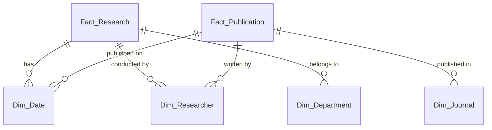

# การออกแบบ Star Schema

Star Schema เป็นรูปแบบการออกแบบ Data Warehouse ที่เน้นความเรียบง่ายและการ Query ข้อมูลที่รวดเร็ว โดยจะมี **Fact Table** อยู่ตรงกลาง และล้อมรอบด้วย **Dimension Tables** ที่ไม่ได้ทำ Normalization จนซับซ้อนเกินไป

สำหรับระบบรายงานผลการดำเนินงานด้านวิจัยและวิชาการ สามารถออกแบบได้ดังนี้:

## 1. Fact Tables (ตารางเก็บข้อมูลเหตุการณ์และตัวเลข)
แยก Fact Table ตาม Business Process หลัก 4 ด้าน:

*   **`Fact_Research` (ข้อมูลโครงการวิจัย)**
    *   `Project_ID` (PK)
    *   `Date_Key` (FK) -> วันที่เริ่ม/สิ้นสุดโครงการ
    *   `Researcher_Key` (FK)
    *   `Department_Key` (FK)
    *   `Funding_Amount` (งบประมาณ - Measure)
*   **`Fact_Publication` (ข้อมูลผลงานตีพิมพ์)**
    *   `Publication_ID` (PK)
    *   `Date_Key` (FK) -> วันที่ตีพิมพ์
    *   `Researcher_Key` (FK)
    *   `Journal_Key` (FK)
    *   `Citation_Count` (จำนวนการอ้างอิง - Measure)
*   **`Fact_Academic_Service` (ข้อมูลบริการวิชาการ)**
    *   `Service_ID` (PK)
    *   `Date_Key` (FK)
    *   `Department_Key` (FK)
    *   `Service_Income` (รายได้จากการบริการ - Measure)
    *   `Participant_Count` (จำนวนผู้เข้าร่วม - Measure)
*   **`Fact_Intellectual_Property` (ข้อมูลทรัพย์สินทางปัญญา)**
    *   `IP_ID` (PK)
    *   `Date_Key` (FK) -> วันที่ยื่นจด/ได้รับ
    *   `Researcher_Key` (FK)
    *   `IP_Type_Key` (FK)

## 2. Dimension Tables (ตารางมุมมองข้อมูล)
*   **`Dim_Date`**: ข้อมูลวันที่ (Date_Key, Date, Month, Quarter, Year, Fiscal_Year)
*   **`Dim_Researcher`**: ข้อมูลนักวิจัย (Researcher_Key, Name, Academic_Rank, Affiliation)
*   **`Dim_Department`**: ข้อมูลหน่วยงาน (Department_Key, Faculty_Name, Department_Name, Unit_Name)
*   **`Dim_Journal`**: ข้อมูลวารสาร (Journal_Key, Journal_Name, Quartile_Score, Database_Index เช่น Scopus/TCI)
*   **`Dim_IP_Type`**: ประเภททรัพย์สินทางปัญญา (IP_Type_Key, IP_Type_Name เช่น สิทธิบัตร/อนุสิทธิบัตร/ลิขสิทธิ์)

### แผนภาพ (Mermaid)

