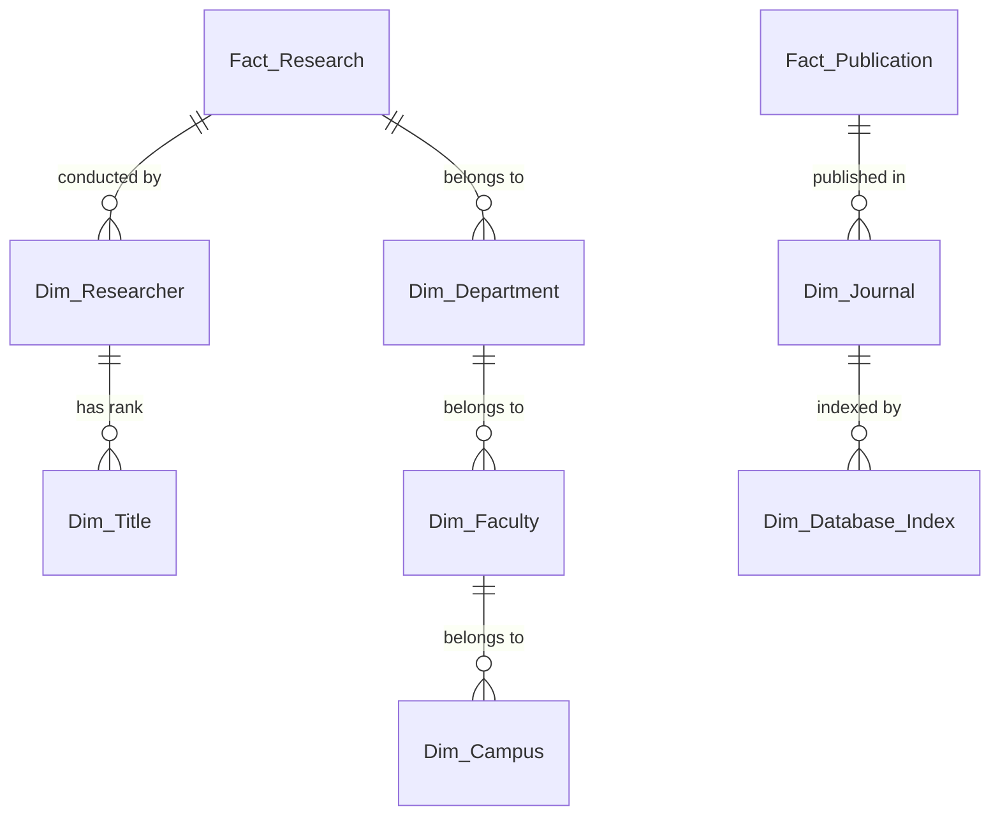

# การออกแบบ Snowflake Schema

Snowflake Schema พัฒนาต่อยอดมาจาก Star Schema โดยทำการ Normalization ตาราง Dimension เพื่อลดความซ้ำซ้อนของข้อมูล (Data Redundancy) ทำให้ดูแลรักษาง่ายขึ้นแต่จะมีการ Join ตารางที่ซับซ้อนขึ้น

สำหรับระบบนี้ เราสามารถแตกตาราง Dimension ที่มีลำดับชั้น (Hierarchy) ชัดเจนได้ดังนี้:

## 1. Fact Tables (ยังคงเหมือน Star Schema)
*   `Fact_Research`
*   `Fact_Publication`
*   `Fact_Academic_Service`
*   `Fact_Intellectual_Property`

## 2. Dimension Tables (Normalized)

*   **ตารางฝั่งองค์กรและนักวิจัย (Organizational & Researcher Hierarchy)**
    *   `Dim_Researcher` ชี้ไปหา `Dim_Title` (ตำแหน่งทางวิชาการ เช่น ผศ., รศ.)
    *   `Dim_Department` (ภาควิชา/หน่วยงาน) ชี้ไปหา `Dim_Faculty` (คณะ) และ `Dim_Campus` (วิทยาเขต)

*   **ตารางฝั่งผลงานทางวิชาการ (Publication Hierarchy)**
    *   `Dim_Journal` ชี้ไปหา `Dim_Database_Index` (ฐานข้อมูล เช่น TCI, Scopus, ISI)

*   **ตารางฝั่งโครงการ (Project Hierarchy)**
    *   `Dim_Project` ชี้ไปหา `Dim_Funding_Source` (แหล่งทุน เช่น ทุนภายใน, ทุนภายนอก)

### แผนภาพ (Mermaid)

## ข้อดีของการใช้ Snowflake กับโปรเจกต์นี้
- ชื่อคณะหรือชื่อแหล่งทุนที่มีความยาวมากๆ จะถูกเก็บเพียงครั้งเดียวในตาราง Master
- เวลาที่มีการเปลี่ยนชื่อภาควิชาหรือคณะ สามารถไปแก้ที่ตาราง Master (เช่น `Dim_Faculty`) ได้เลย โดยไม่ต้องไป Update ทุกๆ แถวใน `Dim_Department`
