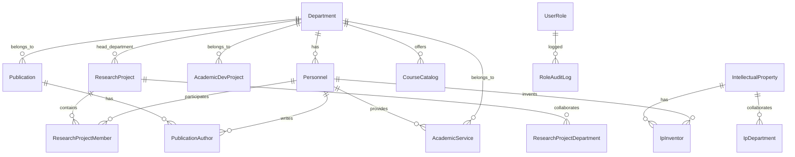

# รายงานการวิเคราะห์ระบบ (Project Analysis Report)
**โครงการ:** ระบบคลังข้อมูลและแดชบอร์ดบริหารจัดการข้อมูลหน่วยวิจัยและนวัตกรรม คณะวิศวกรรมศาสตร์ กำแพงแสน มหาวิทยาลัยเกษตรศาสตร์  
*(KU Engineering Kamphaeng Saen Data Warehouse & Executive Dashboard)*  
**วันที่วิเคราะห์:** 30 ตุลาคม 2569  
**แหล่งข้อมูล:** โครงสร้างโค้ดจริงในโปรเจกต์ `d:\Data warehoues\Project`

---

## 1. ภาพรวมโปรเจค (Project Overview)

### ระบบนี้คืออะไร
ระบบเว็บแอปพลิเคชันคลังข้อมูล (Data Warehouse) และแดชบอร์ดสำหรับผู้บริหารและบุคลากรของคณะวิศวกรรมศาสตร์ กำแพงแสน มหาวิทยาลัยเกษตรศาสตร์ พัฒนาในรูปแบบสถาปัตยกรรมแบบแยกส่วน (Decoupled Architecture) ระหว่าง Frontend Dashboard (Next.js) และ Backend API Service (Express.js + Prisma ORM + PostgreSQL)

### ระบบนี้แก้ปัญหาอะไร
1. **การกระจัดกระจายของข้อมูลพันธกิจ 5 ด้าน:** ข้อมูลโครงการวิจัย, โครงการพัฒนาวิชาการ, ผลงานตีพิมพ์ทางวิชาการ, งานบริการวิชาการ และงานทรัพย์สินทางปัญญา เดิมถูกบันทึกแยกในไฟล์ Excel และรายงานประจำปีหลายฉบับ ขาดฐานข้อมูลกลางที่เชื่อมโยงถึงกัน
2. **ความล่าช้าในการจัดการข้อมูล (CRUD & Validation):** ขาดระบบบริหารจัดการข้อมูลส่วนกลางที่มีฟอร์มมาตรฐาน การนำเข้าข้อมูลจากไฟล์สเปรดชีต (Excel Ingestion) และการตรวจทานความถูกต้องก่อนบันทึก
3. **การประเมินคุณภาพเชิงยุทธศาสตร์ที่ขาดมาตรฐาน:** ขาดระบบอัตโนมัติในการจัดระดับคุณภาพวารสาร (Q1–Q4 / TCI), การเชื่อมโยงเป้าหมายการพัฒนาที่ยั่งยืนแห่งสหประชาชาติ (UN SDGs 1–17), และระดับความพร้อมทางเทคโนโลยี (TRL 1–9)
4. **การติดตามตัวชี้วัด (KPI Monitoring):** ผู้บริหารไม่สามารถตรวจสอบความก้าวหน้าโครงการที่ขอขยายเวลา (Extension Timeline) และตัวชี้วัดเชิงยุทธศาสตร์ได้แบบเรียลไทม์

### กลุ่มผู้ใช้งาน (Target Users)
อ้างอิงจากบทบาทในระบบ ([permissions.ts](file:///d:/Data%20warehoues/Project/backend/src/config/permissions.ts) และ [UserRoleManagementTab.tsx](file:///d:/Data%20warehoues/Project/warehouse_dashboard/src/app/(dashboard)/manage/_components/UserRoleManagementTab.tsx)):
1. **ผู้บริหารคณะ (Executives / Dean / Vice Deans):** ดูภาพรวมสถิติ ตัวชี้วัดยุทธศาสตร์ (KPI), วิเคราะห์ข้อมูลผ่าน Self-Service Studio และส่งออกรายงาน
2. **ผู้ดูแลระบบ (Admin):** จัดการสิทธิ์ผู้ใช้งาน (User Roles), นำเข้าไฟล์ Excel, บันทึก/แก้ไข/ลบข้อมูลผลงาน (CRUD), ประเมินคุณภาพผลงาน (SDG, Journal Quality, TRL)
3. **คณาจารย์และนักวิจัย (Researchers / Faculty Personnel):** ตรวจสอบประวัติผลงานวิชาการ รายการโครงการ และผลงานของตนเองและภาควิชา
4. **ผู้ใช้งานทั่วไปในเครือข่ายนนทรี (User):** เข้าดูแดชบอร์ดสรุปผลและสถิติภาพรวม

---

## 2. Tech Stack และเวอร์ชันที่พบจริงในโปรเจกต์

อ้างอิงจาก [backend/package.json](file:///d:/Data%20warehoues/Project/backend/package.json), [warehouse_dashboard/package.json](file:///d:/Data%20warehoues/Project/warehouse_dashboard/package.json) และ [docker-compose.yml](file:///d:/Data%20warehoues/Project/docker-compose.yml):

### Frontend (`warehouse_dashboard/`)
- **เฟรมเวิร์ก:** Next.js `16.3.0` (App Router, Turbopack, React Server Components & Client Components)
- **UI Runtime:** React `19.2.8`, React DOM `19.2.8`
- **ภาษา:** TypeScript `^5` (Strict Mode)
- **การจัดสไตล์ (CSS / Styling):** Tailwind CSS `^4` (ใช้ `@tailwindcss/postcss` 4, `@theme` ใน `globals.css`), tw-animate-css `^1.4.0`
- **คอมโพเนนต์ Primitives:** Base UI (`@base-ui/react` `^1.9.0`), cmdk `^1.1.1`, Class Variance Authority (`class-variance-authority` `^0.7.1`), clsx `^2.1.1`, tailwind-merge `^3.7.0`
- **ไอคอน:** Lucide React `^1.61.0`, React Icons `^5.7.0` (`react-icons/fa`, `react-icons/fa6`)
- **การพล็อตแผนภูมิและกราฟ:** Chart.js `^4.5.1`, react-chartjs-2 `^5.3.1`, chartjs-plugin-datalabels `^2.2.0`
- **การจัดการวันที่และเอกสาร:** date-fns `^4.4.0`, react-day-picker `^10.0.2`, xlsx `^0.18.5`
- **Data Validation:** Zod `^4.6.7`
- **เครือข่ายและการทดสอบ:** undici `^6.29.1`, Vitest `^3.2.7`, Playwright `^1.64.1`

### Backend (`backend/`)
- **รันไทม์และเฟรมเวิร์ก:** Node.js (v20+), Express.js `^5.0.1`
- **ภาษาและเครื่องมือรันไทม์:** TypeScript `^5.7.3`, tsx `^4.19.3` (ใช้ใน Development), tsc (Production Build)
- **ORM & Database Client:** Prisma `^6.4.1`, `@prisma/client` `^6.4.1`
- **ความปลอดภัยและการยืนยันตัวตน:** jsonwebtoken `^9.0.2`, cors `^2.8.5`, dotenv `^16.4.7`
- **การประมวลผลไฟล์:** multer `^1.4.5-lts.1`
- **การตรวจสอบข้อมูล:** zod `^3.24.2`
- **HTTP Client:** axios `^1.7.9`

### Database & Infrastructure
- **ฐานข้อมูล:** PostgreSQL `16` (Image: `postgres:16-alpine`, รันผ่าน Docker Container `ku_warehouse_db`, พอร์ต `5432`)
- **คอนเทนเนอร์:** Docker & Docker Compose (`docker-compose.yml`, `docker-compose.dev.yml`)
- **ระบบเน็ตเวิร์กภายนอก (Ingress):** Cloudflare Tunnel (`cloudflared`) สำหรับ reverse-proxy พอร์ต 3000/3100 สู่โดเมนภายนอก

---

## 3. โครงสร้างโปรเจกต์ (Project Directory Structure)

```text
d:\Data warehoues\Project\
├── docker-compose.yml           # ไฟล์คอนฟิกหลัก Docker สำหรับรัน db, backend, frontend
├── docker-compose.dev.yml       # คอนฟิก Docker สำหรับโหมด Dev
├── .env.backend / .env.frontend # ไฟล์คอนฟิก Environment Variables
├── start-local-dev.bat          # สคริปต์เปิดฐานข้อมูลและแสดงขั้นตอนรันแบบ Local
├── README.md                    # คู่มือการติดตั้งและรันระบบเบื้องต้น
├── PROJECT_STRUCTURE.md         # เอกสารสถาปัตยกรรมระบบโดยละเอียด
├── backend/                     # แอปพลิเคชัน Express.js API
│   ├── prisma/
│   │   ├── schema.prisma        # โครงสร้างฐานข้อมูลเชิงสัมพันธ์ Prisma Schema
│   │   └── migrations/          # ไฟล์ประวัติ Database Migrations ของ PostgreSQL
│   ├── src/
│   │   ├── index.ts             # จุดเริ่มต้นของเซิร์ฟเวอร์ Express (Port 8000)
│   │   ├── config/              # คอนฟิกค่าตัวแปรระบบ (env.ts) และสิทธิ์ (permissions.ts)
│   │   ├── db/                  # การเชื่อมต่อ Prisma Client (prisma.ts)
│   │   ├── middleware/          # auth.ts, rateLimiter.ts, cookieParser.ts, errorHandler.ts
│   │   ├── routes/              # ตัวจัดการเส้นทาง API (auth, dashboard, admin, data, ฯลฯ)
│   │   ├── services/            # ลอจิกทางธุรกิจ (project, personnel, role, evaluation, ฯลฯ)
│   │   ├── repositories/        # เลเยอร์คิวรีฐานข้อมูลโดยตรงผ่าน Prisma
│   │   ├── types/               # ประกาศ Type/Interface ของ TypeScript ฝั่ง Backend
│   │   └── utils/               # sanitize.ts, sessionCookie.ts
│   └── uploads/                 # โฟลเดอร์จัดเก็บไฟล์อัปโหลดชั่วคราว
├── warehouse_dashboard/         # แอปพลิเคชัน Next.js Dashboard Frontend
│   ├── src/
│   │   ├── proxy.ts             # Gatekeeper Middleware ตรวจสอบ Cookie ku_session และ SSO
│   │   ├── app/                 # Next.js App Router (หน้าเว็บและ Next.js API Routes)
│   │   │   ├── (dashboard)/     # กลุ่มหน้าที่ต้องผ่านการยืนยันตัวตน มี Sidebar & Header
│   │   │   │   ├── overview/    # แดชบอร์ดภาพรวมผู้บริหาร (OverviewView.tsx)
│   │   │   │   ├── research/    # รายการและสถิติโครงการวิจัย (ResearchView.tsx)
│   │   │   │   ├── academic/    # รายการโครงการพัฒนาวิชาการ (AcademicView.tsx)
│   │   │   │   ├── publications/# ผลงานตีพิมพ์และวารสาร (PublicationsView.tsx)
│   │   │   │   ├── service/     # งานบริการวิชาการ (ServiceView.tsx)
│   │   │   │   ├── ip/          # งานทรัพย์สินทางปัญญา (IPView.tsx)
│   │   │   │   ├── kpi/         # การติดตามตัวชี้วัดยุทธศาสตร์ (KPIView.tsx)
│   │   │   │   ├── personnel/   # รายชื่อและประวัติบุคลากร (PersonnelView.tsx, [id]/page.tsx)
│   │   │   │   ├── monitoring/  # ติดตามการขอขยายเวลาโครงการ (MonitoringView.tsx)
│   │   │   │   ├── evaluation/  # การประเมินคุณภาพ SDG, วารสาร, TRL (EvaluationView.tsx)
│   │   │   │   ├── studio/      # แดชบอร์ดวิเคราะห์แบบ Self-Service (SelfServiceStudio.tsx)
│   │   │   │   ├── manage/      # ระบบจัดการข้อมูล CRUD และนำเข้าไฟล์ (ManageView.tsx)
│   │   │   │   └── user-roles/  # การจัดการสิทธิ์ผู้เข้าใช้งาน (UserRolesView.tsx)
│   │   │   ├── api/             # Next.js BFF API Routes (data, evaluation, lookups, auth, health)
│   │   │   ├── login/           # หน้าจอเข้าสู่ระบบบัญชีนนทรี (LoginPage.tsx)
│   │   │   └── sso/             # เส้นทาง SSO Callback & Logout
│   │   ├── components/          # Reusable UI Components (Badges, Drawer, Forms, TopTabs)
│   │   ├── config/              # คอนฟิกหมวดหมู่, เมทาดาตา, SDG, วารสาร, ภาควิชา
│   │   ├── data/                # ชุดข้อมูล JSON สำรองเริ่มต้น (Fallback Seed Datasets)
│   │   ├── features/            # ฟีเจอร์เฉพาะระบบ (auth context, data-import ETL, time-filter)
│   │   ├── lib/                 # ไลบรารีช่วยคำนวณ (analyticsEngine, kpiEngine, sdgEngine, dataService)
│   │   ├── services/            # Client HTTP services (roleManagement.service.ts)
│   │   └── types/               # Type Definitions ของ Frontend
│   └── public/                  # Static Assets, รูปภาพบุคลากร, โลโก้คณะ
├── data/                        # ไฟล์ Excel ต้นฉบับ และพจนานุกรมข้อมูล (Data Dictionaries)
└── db/init/                     # สคริปต์ SQL เริ่มต้นฐานข้อมูลตอนสร้าง Docker Container
```

---

## 4. ฟีเจอร์และโมดูลหลักทั้งหมด (Core Modules & Related Files)

| โมดูล | หน้าที่หลัก | ไฟล์สำคัญที่เกี่ยวข้อง |
|---|---|---|
| **ภาพรวมผู้บริหาร (Overview)** | สรุปภาพรวมผลงาน 5 ด้าน งบประมาณรวม โครงการ Mega Projects และสัดส่วน SDG | `src/app/(dashboard)/overview/page.tsx`<br>`src/app/(dashboard)/overview/_components/OverviewView.tsx`<br>`src/app/(dashboard)/overview/_hooks/useOverviewData.ts` |
| **โครงการวิจัย (Research)** | แสดงสถิติและตารางโครงการวิจัย ทุนภายใน/ภายนอก สถานะโครงการ | `src/app/(dashboard)/research/page.tsx`<br>`src/app/(dashboard)/research/_components/ResearchView.tsx`<br>`src/app/(dashboard)/research/_components/ResearchTable.tsx` |
| **โครงการพัฒนาวิชาการ (Academic)** | ข้อมูลโครงการพัฒนาวิชาการ หน่วยงานผู้ว่าจ้าง งบประมาณ และการบูรณาการ | `src/app/(dashboard)/academic/page.tsx`<br>`src/app/(dashboard)/academic/_components/AcademicView.tsx` |
| **ผลงานตีพิมพ์ทางวิชาการ (Publications)** | ตารางผลงานตีพิมพ์ การจำแนกระดับชาติ/นานาชาติ และเงินสนับสนุน | `src/app/(dashboard)/publications/page.tsx`<br>`src/app/(dashboard)/publications/_components/PublicationsTable.tsx` |
| **งานบริการวิชาการ (Academic Services)** | แสดงงานบริการวิชาการ ประเภทบริการ จำนวนผู้เข้าร่วม และชั่วโมงที่ใช้ | `src/app/(dashboard)/service/page.tsx`<br>`src/app/(dashboard)/service/_components/ServiceView.tsx` |
| **งานทรัพย์สินทางปัญญา (IP)** | ทะเบียนสิทธิบัตร อนุสิทธิบัตร ลิขสิทธิ์ วันที่ยื่นขอ และผู้ประดิษฐ์ | `src/app/(dashboard)/ip/page.tsx`<br>`src/app/(dashboard)/ip/_components/IPView.tsx` |
| **ตัวชี้วัดยุทธศาสตร์ (Strategic KPIs)** | ติดตามคะแนนและการบรรลุเป้าหมายตามแผนยุทธศาสตร์คณะ เปรียบเทียบ Target/Actual | `src/app/(dashboard)/kpi/page.tsx`<br>`src/app/(dashboard)/kpi/_components/KPIView.tsx`<br>`src/lib/kpiEngine.ts` |
| **การติดตามโครงการ (Project Monitoring)** | ติดตามสถานะโครงการที่ขอขยายเวลาสัญญา (Extension Timelines) และกำหนดส่งงาน | `src/app/(dashboard)/monitoring/page.tsx`<br>`src/lib/projectMonitoringEngine.ts` |
| **การประเมินคุณภาพ (Evaluation)** | ประเมินผลงานแบบเดี่ยวและกลุ่ม: UN SDGs (1–17), คุณภาพวารสาร (Q1–Q4, TCI), TRL (1–9) | `src/app/(dashboard)/evaluation/page.tsx`<br>`src/app/(dashboard)/evaluation/_components/EvaluationView.tsx`<br>`src/app/(dashboard)/evaluation/_components/EvaluationDrawer.tsx`<br>`src/app/(dashboard)/evaluation/_components/BulkEvaluationModal.tsx` |
| **ระบบจัดการข้อมูล (Master Data CRUD)** | ฟอร์มเพิ่ม/แก้ไข/ลบข้อมูลผลงาน 5 หมวด และบุคลากร รองรับ Tag อัตโนมัติ | `src/app/(dashboard)/manage/page.tsx`<br>`src/app/(dashboard)/manage/_components/DataManagementRoot.tsx`<br>`src/app/(dashboard)/manage/_components/DataTable.tsx`<br>`src/components/ui/RecordDetailDrawer.tsx` |
| **การนำเข้าข้อมูล (Excel Ingestion & ETL)** | ระบบนำเข้าสเปรดชีต ตรวจจับคอลัมน์อัตโนมัติ แสดงตัวอย่างก่อนบันทึก | `src/features/data-import/components/UniversalExcelImportModal.tsx`<br>`src/features/data-import/etl/universalImportEngine.ts` |
| **สตูดิโอวิเคราะห์ข้อมูล (Self-Service Studio)** | เครื่องมือสร้างแผนภูมิอิสระ เลือกมิติ (Dimension) ตัวชี้วัด (Measure) และ Drill-down ได้เอง | `src/app/(dashboard)/studio/page.tsx`<br>`src/app/(dashboard)/studio/_components/SelfServiceStudio.tsx`<br>`src/lib/analyticsEngine.ts` |
| **ข้อมูลบุคลากร (Personnel)** | ทำเนียบคณาจารย์ แยกตามภาควิชา แสดงประวัติผลงานวิจัย ทรัพย์สินทางปัญญา | `src/app/(dashboard)/personnel/page.tsx`<br>`src/app/(dashboard)/personnel/[id]/_components/PersonnelDetailView.tsx` |
| **การจัดการสิทธิ์ผู้ใช้ (User Roles)** | กำหนดและแก้ไขสิทธิ์ผู้ใช้งาน (Admin / User) ปรับลดสิทธิ์ และดู Audit Logs | `src/app/(dashboard)/user-roles/page.tsx`<br>`src/app/(dashboard)/manage/_components/UserRoleManagementTab.tsx`<br>`backend/src/services/role.service.ts` |

---

## 5. Flow การทำงานสำคัญ (Key Workflows)

### Flow 1: การเข้าสู่ระบบและการควบคุมสิทธิ์ (Authentication & RBAC)
1. ผู้ใช้เข้าหน้าเว็บ ระบบตรวจหา Cookie `ku_session` ผ่าน [proxy.ts](file:///d:/Data%20warehoues/Project/warehouse_dashboard/src/proxy.ts)
2. หากไม่มี Cookie ระบบจะ Redirect ไปที่หน้า `/login?returnUrl=...`
3. ผู้ใช้กรอกบัญชีผู้ใช้เครือข่ายนนทรี (Nontri Account เช่น `b6520503525`) และรหัสผ่าน ส่งมายัง `POST /api/v1/auth/login` ([auth.routes.ts](file:///d:/Data%20warehoues/Project/backend/src/routes/auth.routes.ts))
4. Backend ทำการตรวจสอบรูปแบบบัญชี และดึงสิทธิ์ล่าสุดจากตาราง `user_roles` ใน PostgreSQL
5. Backend สร้างคุกกี้ `ku_session` ที่ลงนามดิจิทัลด้วย HMAC-SHA256 (อายุ 8 ชั่วโมง, HttpOnly, SameSite=Lax)
6. ผู้ใช้เข้าสู่ระบบ Frontend context `AuthContext` ได้รับข้อมูลบทบาท (`role: 'admin'` หรือ `'user'`) เพื่อควบคุมการเข้าถึงปุ่มแก้ไข/ลบ/จัดการข้อมูล

### Flow 2: การบันทึกและแก้ไขข้อมูลผลงาน (CRUD Operations & Persistence)
1. ผู้ดูแลระบบเปิดแท็บในหน้า `/manage` และกดปุ่ม "เพิ่มรายการ" หรือ "แก้ไขข้อมูล"
2. กรอกข้อมูลผ่านแบบฟอร์มเฉพาะหมวดหมู่ (เช่น [ResearchProjectForm.tsx](file:///d:/Data%20warehoues/Project/warehouse_dashboard/src/app/(dashboard)/manage/_components/ResearchProjectForm.tsx))
3. เมื่อกดยืนยัน ฟังก์ชัน `saveCategoryRecord` ใน [dataService.ts](file:///d:/Data%20warehoues/Project/warehouse_dashboard/src/lib/dataService.ts) จะส่งคำขอแบบ `POST` (สร้างใหม่) หรือ `PUT` (แก้ไข) ไปยัง `/api/v1/data/:category`
4. Express Backend รับคำขอผ่าน [data.routes.ts](file:///d:/Data%20warehoues/Project/backend/src/routes/data.routes.ts) ตรวจสอบสิทธิ์ผ่าน `requireRole('manage')`
5. [project.service.ts](file:///d:/Data%20warehoues/Project/backend/src/services/project.service.ts) ทำการแปลงข้อมูล (เช่น แปลงชื่อภาควิชาเป็น Department Code, แมปหัวหน้าโครงการกับตาราง Personnel) และบันทึกลงฐานข้อมูล PostgreSQL ผ่าน Prisma
6. หน้าเว็บอัปเดต Local Cache ใน `localStorage` ทันที และส่ง Event `ku_data_updated` เพื่อให้ทุกแท็บและแดชบอร์ดรีเฟรชข้อมูล

### Flow 3: การประเมินคุณภาพผลงานวิชาการ (Evaluation Workflow)
1. ผู้ใช้เปิดหน้า `/evaluation` ตารางจะแสดงรายการผลงานพร้อมสถานะ "ประเมินแล้ว" หรือ "ยังไม่ประเมิน"
2. ผู้ใช้สามารถคลิกเปิด [EvaluationDrawer.tsx](file:///d:/Data%20warehoues/Project/warehouse_dashboard/src/app/(dashboard)/evaluation/_components/EvaluationDrawer.tsx) เพื่อประเมินรายตัว หรือเลือกเช็กบ็อกซ์หลายรายการเพื่อเปิด [BulkEvaluationModal.tsx](file:///d:/Data%20warehoues/Project/warehouse_dashboard/src/app/(dashboard)/evaluation/_components/BulkEvaluationModal.tsx)
3. ระบบจะทำการเดาคุณภาพผลงานเบื้องต้น (Auto-detection):
   - ตรวจจับ SDG จากคีย์เวิร์ดชื่อเรื่องผ่าน `detectSDGsFromText` ([sdgEngine.ts](file:///d:/Data%20warehoues/Project/warehouse_dashboard/src/lib/sdgEngine.ts))
   - ตรวจจับระดับคุณภาพวารสาร (Q1–Q4 หรือ TCI กลุ่ม 1–2) จากชื่อวารสารผ่าน `autoDetectJournalRanking` ([journalRankingEngine.ts](file:///d:/Data%20warehoues/Project/warehouse_dashboard/src/lib/journalRankingEngine.ts))
4. ผู้ประเมินตรวจสอบและปรับแก้ค่าเป้าหมาย SDG, ประเภทงาน I-Type, และคุณภาพวารสาร จากนั้นกดยืนยัน
5. ข้อมูลส่งไปยัง `POST /api/v1/evaluation` ([evaluation.routes.ts](file:///d:/Data%20warehoues/Project/backend/src/routes/evaluation.routes.ts)) และทำการ Upsert ลงในตาราง `evaluations`
6. ป้าย Tag ([SdgBadge](file:///d:/Data%20warehoues/Project/warehouse_dashboard/src/components/ui/evaluation-tag.tsx), [JournalQualitySelect](file:///d:/Data%20warehoues/Project/warehouse_dashboard/src/components/ui/JournalQualitySelect.tsx)) จะแสดงผลอัปเดตทันทีทั้งในหน้าจัดการและแดชบอร์ด

### Flow 4: การนำเข้าข้อมูลผ่านไฟล์ Excel (Excel Ingestion ETL)
1. ผู้ดูแลระบบกดปุ่ม "นำเข้าไฟล์ Excel" ในหน้าจัดการข้อมูล
2. เลือกหมวดหมู่ที่ต้องการนำเข้า และอัปโหลดไฟล์ `.xlsx` เข้าสู่โมดอล [UniversalExcelImportModal.tsx](file:///d:/Data%20warehoues/Project/warehouse_dashboard/src/features/data-import/components/UniversalExcelImportModal.tsx)
3. เอนจิน [universalImportEngine.ts](file:///d:/Data%20warehoues/Project/warehouse_dashboard/src/features/data-import/etl/universalImportEngine.ts) ประมวลผลบนเบราว์เซอร์ด้วยไลบรารี `xlsx`:
   - อ่านชีต แปลงชื่อคอลัมน์ภาษาไทยเทียบกับ Column Dictionary
   - ตรวจสอบรูปแบบ วันที่ พ.ศ./ค.ศ. จำนวนเงิน และชื่อผู้รับผิดชอบ
   - แสดงสถานะผลการตรวจสอบ: ข้อมูลสมบูรณ์ (พร้อมนำเข้า) หรือข้อมูลไม่ครบถ้วน
4. ผู้ใช้ตรวจทานข้อมูลในแบบ Split-Pane และกดยืนยันนำเข้าข้อมูล
5. ระบบทำการบันทึกข้อมูลเข้าระบบผ่าน `saveCategoryRecord` และซิงค์ลงฐานข้อมูล

---

## 6. โครงสร้างข้อมูล (Database Schema & Models)

อ้างอิงจาก [backend/prisma/schema.prisma](file:///d:/Data%20warehoues/Project/backend/prisma/schema.prisma):



### รายละเอียดตารางหลัก (Core Tables)

1. **`departments` (ภาควิชา/หน่วยงาน)**
   - `code` (PK, VarChar(10)): รหัสภาควิชา เช่น `ME`, `CE`, `CPE`, `EEEC`, `IE`, `FE`, `AE`, `OFS`
   - `name_th` (VarChar(255)), `name_en` (VarChar(255)), `is_canonical` (Boolean)
2. **`personnel` (บุคลากร/อาจารย์)**
   - `id` (PK, Int Auto), `person_id` (Unique VarChar(50)), `title_th`, `name_th`, `name_en`, `position`, `department_code` (FK -> departments), `email`, `image_url`
3. **`research_projects` (โครงการวิจัย)**
   - `id` (PK, Int Auto), `legacy_id` (Unique VarChar(100)), `code`, `name`, `head_name`, `head_personnel_id` (FK -> personnel), `head_department_code` (FK -> departments), `status`, `budget_internal`, `budget_external`, `fund_source`, `fund_type`, `collaboration_type`, `project_nature`, `start_date`, `end_date`, `fiscal_year`, `trl_outputs` (Text)
   - ตารางเชื่อมโยง: `research_project_members` (ผู้ร่วมวิจัย), `research_project_departments` (ภาควิชาที่ร่วม)
4. **`academic_dev_projects` (โครงการพัฒนาวิชาการ)**
   - `id` (PK, Int Auto), `legacy_id` (Unique), `name`, `head_name`, `head_personnel_id` (FK), `department_code` (FK), `client`, `budget`, `fiscal_year`, `start_date`, `end_date`, `integration_start_date`, `integration_end_date`
5. **`publications` (ผลงานตีพิมพ์ทางวิชาการ)**
   - `id` (PK, Int Auto), `legacy_id` (Unique), `title`, `type`, `level` (ชาติ/นานาชาติ), `journal`, `volume`, `issue`, `page_start`, `page_end`, `budget`, `first_author_name`, `department_code` (FK), `fiscal_year_be`, `status`, `remarks`
   - ตารางเชื่อมโยง: `publication_authors` (ผู้ประพันธ์และผู้ร่วม)
6. **`academic_services` (งานบริการวิชาการ)**
   - `id` (PK, Int Auto), `legacy_id` (Unique), `name`, `service_category`, `provider_name`, `department_code` (FK), `target_group`, `hours_spent`, `attendees_count`, `date`, `fiscal_year`
7. **`intellectual_properties` (งานทรัพย์สินทางปัญญา)**
   - `id` (PK, Int Auto), `legacy_id` (Unique), `title`, `type` (สิทธิบัตร/อนุสิทธิบัตร/ลิขสิทธิ์), `creator_name`, `department_code` (FK), `application_number`, `registration_number`, `filing_date`, `protection_start`, `support_amount`, `status`, `fiscal_year`
   - ตารางเชื่อมโยง: `ip_inventors` (ผู้ประดิษฐ์), `ip_departments` (ภาควิชาเจ้าของร่วม)
8. **`evaluations` (ผลการประเมินคุณภาพ)**
   - `id` (PK, Int Auto), `category` (VarChar(50)), `record_id` (VarChar(100)), `sdg_ids` (Int[]), `i_type` (VarChar(50)), `journal_index` (VarChar(100)), `evaluated_by`, `evaluated_at`
   - Unique Index: `[category, record_id]`
9. **`user_roles` และ `role_audit_logs` (การจัดการสิทธิ์และประวัติ)**
   - `user_roles`: `username` (PK, VarChar(100)), `role` (VarChar(50)), `is_protected` (Boolean), `display_name`, `granted_by`, `granted_at`, `note`, `updated_at`
   - `role_audit_logs`: `id` (PK, BigInt Auto), `actor_username`, `action`, `target_username`, `old_role`, `new_role`, `created_at`
10. **ตารางประกอบ (Lookups)**
    - `course_catalog` (หลักสูตรรายวิชาสำหรับแมปการบูรณาการการสอน), `funding_sources` (แหล่งทุนวิจัย)

---

## 7. รายการ API / Endpoints ทั้งหมดในระบบ

### Express Backend Endpoints (Base: `http://localhost:8000`)
อ้างอิงจาก `backend/src/routes/*.ts`:

| หมวดหมู่ | Method | Path | การตรวจสอบสิทธิ์ / สิทธิ์ที่ต้องการ | คำอธิบาย |
|---|---|---|---|---|
| **Health** | `GET` | `/health`, `/api/health`, `/api/v1/health` | Public | ตรวจสอบสถานะการเชื่อมต่อ Express และ PostgreSQL |
| **Auth** | `POST` | `/api/v1/auth/login` | Rate Limiter | เข้าสู่ระบบด้วยบัญชีนนทรี / Mock Login |
| | `POST` | `/api/v1/auth/session` | Rate Limiter | ตรวจสอบ session ปัจจุบัน |
| | `GET` | `/api/v1/auth/login-url` | Public | ดึง URL สำหรับทำ OAuth กับระบบ KU ALL-Login |
| | `POST` | `/api/v1/auth/exchange` | Public | แลกเปลี่ยน Authorization Code จาก ALL-Login |
| | `GET` | `/api/v1/auth/me` | requireSession | ดึงโปรไฟล์และบทบาทของผู้ใช้ปัจจุบัน |
| | `POST` | `/api/v1/auth/logout` | Public | ล็อกเอาต์และล้างคุกกี้เซสชัน |
| **Data CRUD** | `GET` | `/api/v1/data/:category` | Public / Session | ดึงรายการข้อมูลตามหมวด (`research`, `academic`, `publications`, ฯลฯ) |
| | `POST` | `/api/v1/data/:category` | requireRole('manage') | เพิ่มรายการข้อมูลใหม่ลงใน PostgreSQL |
| | `PUT` | `/api/v1/data/:category` | requireRole('manage') | อัปเดตข้อมูลรายการเดิม |
| | `DELETE`| `/api/v1/data/:category` | requireRole('manage') | ลบรายการข้อมูลออกจากฐานข้อมูล |
| **Evaluation**| `GET` | `/api/v1/evaluation` | Public / Session | ดึงรายการประเมินทั้งหมด (SDGs, Journal Index, I-Type) |
| | `POST` | `/api/v1/evaluation` | requireSession | บันทึกผลการประเมินรายชิ้น |
| | `POST` | `/api/v1/evaluation/bulk` | requireSession | บันทึกผลการประเมินแบบกลุ่ม (Batch) |
| | `DELETE`| `/api/v1/evaluation` | requireRole('manage') | ล้างผลการประเมินของรายการที่ระบุ |
| **Admin** | `GET` | `/api/v1/admin/verify` | requireRole('manage') | ตรวจสอบความถูกต้องของสิทธิ์ผู้ดูแลระบบ |
| | `POST` | `/api/v1/admin/etl/upload` | requireRole('manage') | รับไฟล์ Excel สำหรับนำเข้าผ่านระบบเบื้องหลัง |
| | `GET` | `/api/v1/admin/roles` | requireRole('user_roles') | รายชื่อผู้ใช้งานและบทบาทในระบบ |
| | `POST` | `/api/v1/admin/roles` | requireRole('user_roles') | เพิ่มบทบาทผู้ใช้งานใหม่ |
| | `PATCH`| `/api/v1/admin/roles/:username` | requireRole('user_roles') | แก้ไขบทบาท (ลดสิทธิ์เป็น user / ปรับเป็น admin) |
| | `DELETE`| `/api/v1/admin/roles/:username`| requireRole('user_roles') | ลบผู้ใช้ออกจากตารางสิทธิ์ |
| | `GET` | `/api/v1/admin/roles/audit-logs` | requireRole('user_roles') | ตรวจสอบประวัติการเปลี่ยนสิทธิ์ย้อนหลัง |
| **Dashboard**| `GET` | `/api/v1/dashboard/overview` | Public / Session | ดึงข้อมูลสถิติรวมสำหรับหน้า Overview |
| | `GET` | `/api/v1/dashboard/research` | Public / Session | ดึงสรุปสถิติด้านวิจัย |
| | `GET` | `/api/v1/dashboard/academic` | Public / Session | ดึงสรุปสถิติด้านพัฒนาวิชาการ |
| | `GET` | `/api/v1/dashboard/publications` | Public / Session | ดึงสรุปสถิติผลงานตีพิมพ์ |
| | `GET` | `/api/v1/dashboard/services` | Public / Session | ดึงสรุปสถิติด้านบริการวิชาการ |
| | `GET` | `/api/v1/dashboard/ip` | Public / Session | ดึงสรุปสถิติด้านทรัพย์สินทางปัญญา |
| **Personnel**| `GET` | `/api/v1/personnel` | requireRole('personnel') | รายชื่ออาจารย์และบุคลากร |
| | `GET` | `/api/v1/personnel/:id` | requireRole('personnel') | ข้อมูลประวัติและผลงานรายบุคคล |
| **Lookups** | `GET` | `/api/v1/lookups/departments` | Public | รายชื่อภาควิชาและสังกัดมาตรฐาน |
| | `GET` | `/api/v1/lookups/funding-sources`| Public | รายชื่อแหล่งทุนวิจัย |
| | `GET` | `/api/v1/lookups/courses` | Public | รายวิชาในหมวดหลักสูตร |

### Next.js Internal API Routes (`warehouse_dashboard/src/app/api/`)
- `GET/POST/PUT/DELETE /api/data/[category]` (BFF Proxy ส่งคำขอต่อไปยัง Backend)
- `GET/POST/DELETE /api/evaluation` และ `POST /api/evaluation/bulk`
- `GET /api/lookups/personnel`, `courses`, `funding-sources`
- `GET /api/health`
- `GET /api/auth/session`, `roles`, `portal-session`
- `GET /sso/login`, `GET /sso/logout`

---

## 8. การจัดการความปลอดภัย (Security & Governance)

1. **การยืนยันตัวตน (Authentication):**
   - ใช้งาน Session Cookie ชื่อ `ku_session` ซึ่งเข้ารหัสและตรวจสอบลายมือชื่อแบบดิจิทัลด้วยอัลกอริทึม **HMAC-SHA256** อ้างอิง Secret Key จาก `AUTH_SESSION_SECRET` ([sessionCookie.ts](file:///d:/Data%20warehoues/Project/backend/src/utils/sessionCookie.ts))
   - รองรับการเข้าสู่ระบบแบบ SSO กับระบบ **KU ALL-Login** (OAuth 2.0 / OpenID Connect + PKCE)
   - มีระบบ Cookie Security: กำหนดแฟล็ก `HttpOnly: true`, `SameSite: 'Lax'`, และ `Secure: true` (เมื่อทำงานบน HTTPS)
2. **การควบคุมสิทธิ์ตามบทบาท (Role-Based Access Control - RBAC):**
   - มีลำดับชั้นสิทธิ์ตามที่กำหนดใน [permissions.ts](file:///d:/Data%20warehoues/Project/backend/src/config/permissions.ts):
     - `admin`: มีสิทธิ์ระดับจัดการข้อมูล (`manage`), จัดการผู้ใช้ (`user_roles`), เข้าถึงได้ทุกโมดูล
     - `user`: เข้าถึงข้อมูลเพื่อดูและส่งออกรายงาน แต่ไม่มีสิทธิ์ในการแก้ไขหรือลบ
   - ป้องกันการลดสิทธิ์หรือลบ Admin คนสุดท้ายในระบบ (`LAST_ADMIN_PROTECTED`) เพื่อป้องกันระบบไร้ผู้ดูแล
3. **เกตเวย์ระดับ Frontend (Next.js Proxy Gatekeeper):**
   - [proxy.ts](file:///d:/Data%20warehoues/Project/warehouse_dashboard/src/proxy.ts) ตรวจสอบคำขอทุกครั้งก่อนอนุญาตให้เข้าสู่เส้นทางที่เป็น Protected Routes เช่น `/manage`, `/evaluation`, `/kpi` หากไม่พบเซสชันจะรีไดเรกต์ไปยังหน้าเข้าสู่ระบบพร้อมแนบ `returnUrl`
4. **การป้องกันการโจมตี (Rate Limiting & Input Sanitization):**
   - มี In-Memory Rate Limiter ([rateLimiter.ts](file:///d:/Data%20warehoues/Project/backend/src/middleware/rateLimiter.ts)) ป้องกันการ Brute-force รหัสผ่านที่จุดล็อกอิน
   - การคัดกรองข้อมูลเข้า ([sanitize.ts](file:///d:/Data%20warehoues/Project/backend/src/utils/sanitize.ts)) ป้องกัน Prototype Pollution และการคัดกรองอักขระแปลกปลอมในชื่อผู้ใช้
5. **CORS Policy:**
   - Express Backend กำหนด Whitelist โดเมนที่อนุญาตอย่างเข้มงวดผ่านตัวแปร `CORS_ORIGIN` รองรับทั้ง Localhost และ Cloudflare Tunnel Domain

---

## 9. วิธีติดตั้งและรันระบบ (Installation & Getting Started)

อ้างอิงจาก [README.md](file:///d:/Data%20warehoues/Project/README.md) และ [docker-compose.yml](file:///d:/Data%20warehoues/Project/docker-compose.yml):

### สิ่งที่ต้องติดตั้งล่วงหน้า (Prerequisites)
- Docker Desktop และ Docker Compose
- Node.js เวอร์ชัน 20 หรือสูงกว่า

### ทางเลือกที่ 1: รันแบบครบวงจรผ่าน Docker (Recommended for Deployment)
```bash
# คัดลอกไฟล์คอนฟิก
cp .env.example .env
cp .env.backend.example .env.backend
cp .env.frontend.example .env.frontend

# สั่ง Build และรันทั้ง Database, Backend และ Frontend
docker compose up -d --build
```
- Frontend เข้าใช้งานได้ที่: `http://localhost:3000` (หรือพอร์ต `3100` ใน instance ทดสอบ)
- Backend API ทำงานที่: `http://localhost:8000`
- Database ทำงานที่พอร์ต: `5432`

### ทางเลือกที่ 2: รันในโหมด Development บนเครื่อง (Local Dev)
1. **เปิดฐานข้อมูล PostgreSQL ผ่าน Docker:**
   ```powershell
   docker compose up -d db
   ```
2. **รัน Backend API (Terminal 1):**
   ```powershell
   cd backend
   npm install
   npx prisma generate
   npx prisma migrate deploy
   npm run dev
   # เซิร์ฟเวอร์จะเปิดที่ http://localhost:8000
   ```
3. **รัน Frontend Dashboard (Terminal 2):**
   ```powershell
   cd warehouse_dashboard
   npm install
   npm run dev
   # เข้าใช้งานผ่านเว็บเบราว์เซอร์ที่ http://localhost:3000
   ```

---

## 10. การทดสอบที่มีอยู่จริงในระบบ (Testing Status)

จากการตรวจสอบไฟล์ทดสอบจริงในโฟลเดอร์ `warehouse_dashboard/src/`:
- **เฟรมเวิร์กการทดสอบ:** Vitest `3.2.7`
- **ผลการทดสอบล่าสุด:** **ผ่านทั้งหมด 19 Test Files (รวม 179 Tests)**
- **ขอบเขตการทดสอบครอบคลุม:**
  1. *ระบบความปลอดภัยและเซสชัน (Auth & Session):*
     - `src/lib/auth/__tests__/session.test.ts` (16 การทดสอบ)
     - `src/app/api/auth/__tests__/session.test.ts` (4 การทดสอบ)
     - `src/app/api/auth/__tests__/portal-session.test.ts` (18 การทดสอบ)
     - `src/lib/auth/__tests__/guard.test.ts` (7 การทดสอบ)
     - `src/lib/auth/__tests__/logout.test.ts` (4 การทดสอบ)
  2. *เกตเวย์และกฎการ Redirect (Proxy & Safe Redirect):*
     - `src/lib/auth/__tests__/proxyRules.test.ts` (10 การทดสอบ)
     - `src/lib/auth/__tests__/safeRedirect.test.ts` (23 การทดสอบ)
     - `src/lib/auth/__tests__/proxy.test.ts` (3 การทดสอบ)
  3. *การจัดการสิทธิ์และบัญชีผู้ใช้ (Roles & Identifiers):*
     - `src/app/api/auth/__tests__/roles.test.ts` (8 การทดสอบ)
     - `src/lib/auth/__tests__/normalizeRoles.test.ts` (10 การทดสอบ)
     - `src/lib/auth/__tests__/nontriId.test.ts` (8 การทดสอบ)
  4. *การนำเข้าข้อมูลและเอนจิน ETL (Data Import & Validation):*
     - `src/features/data-import/etl/importEtl.test.ts` (5 การทดสอบ)
     - `src/features/import/global/globalImport.etl.test.ts` (10 การทดสอบ)
     - `src/features/import/academic-dev/importAcademicDev.etl.test.ts` (11 การทดสอบ - ทดสอบการพาร์สไฟล์ Excel จริง)
  5. *ระบบตรวจสอบสุขภาพของระบบ:*
     - `src/app/api/health/__tests__/health.test.ts` (2 การทดสอบ)

*(หมายเหตุ: ในโฟลเดอร์ `backend/` ไม่พบชุดไฟล์ทดสอบแบบ Automated Unit Test ในโค้ดปัจจุบัน การทดสอบการเชื่อมต่อและการทำงานของ API อาศัยการเรียกผ่าน End-to-end ของ Next.js BFF และการรันจริง)*

---

## 11. ข้อจำกัดและส่วนที่ยังไม่สมบูรณ์ที่สังเกตเห็นจากโค้ด (Limitations & Observations)

1. **สถาปัตยกรรมการจัดเก็บข้อมูลแบบคู่ขนาน (Dual-store Behavior):**
   - ฟังก์ชัน `dataService.ts` มีการอ่านและแคชข้อมูลลงใน `localStorage` (`ku_dw_cache_*`) เมื่อเชื่อมต่อ Backend ไม่สำเร็จจะนำชุดข้อมูลเริ่มต้น (JSON Seed ใน `src/data/`) มาเป็น Fallback ซึ่งอาจทำให้ข้อมูลในเครื่องของไคลเอนต์ที่เคลียร์แคชกับข้อมูลในฐานข้อมูล PostgreSQL แสดงผลไม่พร้อมเพรียงกันในบางกรณี
2. **เอนด์พอยต์ ETL Upload ใน Backend เป็นโครงร่าง (Stub):**
   - ใน `backend/src/routes/admin.routes.ts` บรรทัดที่ 54 เมธอด `POST /etl/upload` มีการรับไฟล์ Excel และบันทึกลงโฟลเดอร์ `uploads/` พร้อมส่งข้อความตอบกลับว่า *"queued for ETL processing"* แต่ยังไม่มีคิวงาน (Worker Queue) ในฝั่ง Express ทำการประมวลผลไฟล์ต่อจริง โดยการประมวลผล ETL นำเข้าสเปรดชีตหลักในปัจจุบันดำเนินการผ่านเอนจินฝั่ง Frontend (`UniversalExcelImportModal.tsx`) เป็นหลัก
3. **TypeScript Compilation Mismatch ใน Backend:**
   - ใน `backend/src/services/project.service.ts` มี Type mismatch ระหว่าง Prisma relation queries (`include: { departments: ..., members: ... }`) กับ Service Return Type ทำให้คำสั่ง `tsc` รายงาน error `TS2322` จึงต้องใส่ `RUN npm run build || true` ไว้ใน Dockerfile ของ Backend
4. **โหมด Mock Authentication ในการพัฒนา:**
   - ใน `backend/src/config/env.ts` และ `backend/src/routes/auth.routes.ts` มีการรองรับโหมด `AUTH_MOCK_ENABLED=true` เพื่อความสะดวกในการทดสอบโดยไม่ต้องเชื่อมต่อระบบ KU ALL-Login ของมหาวิทยาลัยจริง ซึ่งต้องมั่นใจว่าตัวแปรนี้ถูกปิดเป็น `false` เสมอใน Production Environment
5. **โครงสร้างสิทธิ์รองรับ 2 ระดับหลัก:**
   - แม้ในสคีมาและโค้ดดั้งเดิมจะเคยระบุถึงบทบาทระดับคณะกรรมการหรือบุคลากร แต่ในโครงสร้าง UI และการใช้งานจริงปัจจุบัน ระบบเน้นการทำงาน 2 ระดับ คือ `admin` (เข้าถึงหน้าจัดการและแก้ไขข้อมูลได้ทั้งหมด) และ `user` (ดูข้อมูลและส่งออกได้อย่างเดียว)
