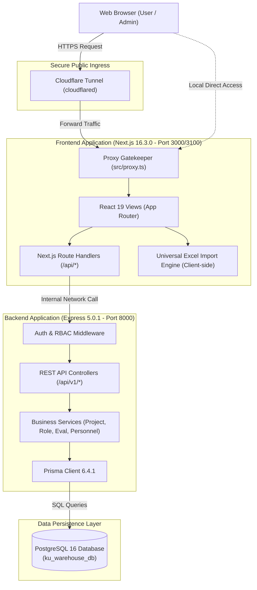
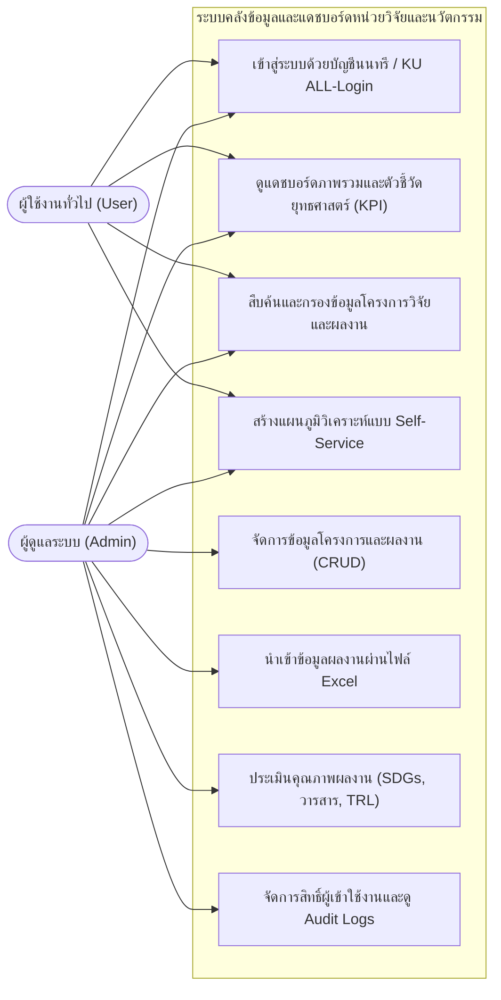
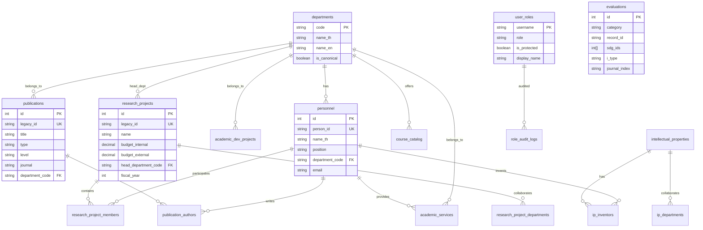
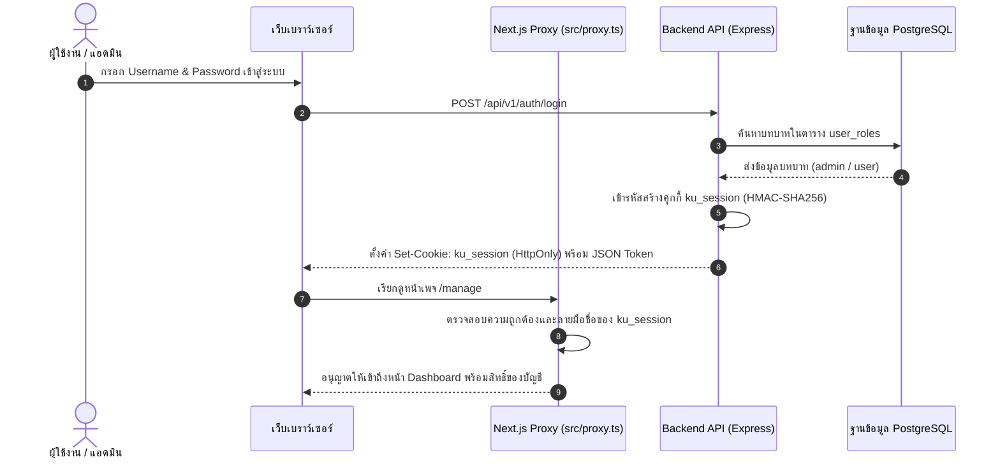
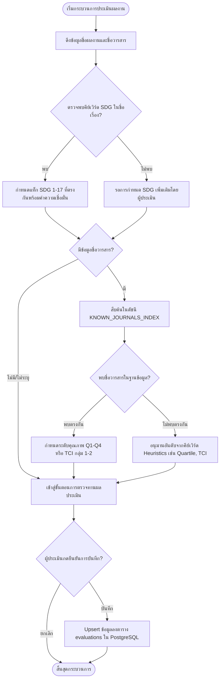

# รายงานการพัฒนาซอฟต์แวร์
## ระบบคลังข้อมูลและแดชบอร์ดบริหารจัดการข้อมูลหน่วยวิจัยและนวัตกรรม
### คณะวิศวกรรมศาสตร์ กำแพงแสน มหาวิทยาลัยเกษตรศาสตร์
**(KU Engineering Kamphaeng Saen Data Warehouse & Executive Dashboard)**

---

**ผู้จัดทำ:**  
[TODO: ใส่ชื่อ-นามสกุล และรหัสนิสิตของผู้จัดทำ]  

**อาจารย์ที่ปรึกษา:**  
[TODO: ใส่ชื่อ-นามสกุล และตำแหน่งวิชาการของอาจารย์ที่ปรึกษา]  

**ภาควิชา/คณะ:**  
[TODO: ใส่ชื่อภาควิชา เช่น ภาควิชาวิศวกรรมคอมพิวเตอร์ คณะวิศวกรรมศาสตร์ กำแพงแสน มหาวิทยาลัยเกษตรศาสตร์]  
**ปีการศึกษา:** [TODO: ใส่ปีการศึกษา เช่น 2568 หรือ 2569]  

---

## บทคัดย่อ (Abstract)

รายงานฉบับนี้นำเสนอการพัฒนาระบบคลังข้อมูลและแดชบอร์ดบริหารจัดการข้อมูลหน่วยวิจัยและนวัตกรรม คณะวิศวกรรมศาสตร์ กำแพงแสน มหาวิทยาลัยเกษตรศาสตร์ ซึ่งออกแบบและพัฒนาขึ้นเพื่อแก้ปัญหาการจัดเก็บข้อมูลผลงานพันธกิจ 5 ด้าน ได้แก่ โครงการวิจัย โครงการพัฒนาวิชาการ ผลงานตีพิมพ์ทางวิชาการ งานบริการวิชาการ และงานทรัพย์สินทางปัญญา ที่เดิมจัดเก็บกระจัดกระจายในรูปแบบไฟล์สเปรดชีตและรายงานประจำปี ขาดศูนย์กลางการเชื่อมโยงข้อมูล และขาดกลไกประเมินคุณภาพเชิงยุทธศาสตร์ที่สอดคล้องกับมาตรฐานสากล

ระบบได้รับการพัฒนาภายใต้สถาปัตยกรรมแบบแยกส่วน (Decoupled Web Architecture) โดยใช้ Next.js 16 (App Router และ Turbopack) สำหรับส่วนติดต่อผู้ใช้และแดชบอร์ดการวิเคราะห์ และใช้ Express.js ร่วมกับ Prisma ORM เชื่อมต่อกับฐานข้อมูลเชิงสัมพันธ์ PostgreSQL 16 ซึ่งจัดเก็บข้อมูลทั้งแบบ Operational Database และโครงสร้างเตรียมพร้อมสำหรับการวิเคราะห์ข้อมูล ระบบประกอบด้วยฟังก์ชันหลักในการจัดการข้อมูลแบบครบวงจร (CRUD) ระบบนำเข้าไฟล์สเปรดชีต Excel อัจฉริยะ (Client-side ETL Ingestion) ระบบประเมินคุณภาพอัตโนมัติ (Automated Evaluation Engine) รองรับการจัดระดับวารสาร (Q1–Q4 / TCI) เป้าหมายการพัฒนาที่ยั่งยืน (UN SDGs 1–17) และระดับความพร้อมทางเทคโนโลยี (TRL 1–9) ตลอดจนระบบติดตามตัวชี้วัดยุทธศาสตร์ (KPI Monitoring) และสตูดิโอวิเคราะห์ข้อมูลแบบบริการตนเอง (Self-Service Analytics Studio)

ผลการทดสอบการทำงานระดับหน่วยและการทดสอบการรวมระบบด้วย Vitest จำนวน 19 ชุดทดสอบ (รวม 179 การทดสอบ) พบว่าผ่านการทดสอบสมบูรณ์ 100% ครอบคลุมทั้งระบบความปลอดภัย การยืนยันตัวตนด้วยเซสชันคุกกี้เข้ารหัส HMAC-SHA256 การควบคุมสิทธิ์ตามบทบาท (RBAC) และการตรวจสอบความถูกต้องของการนำเข้าข้อมูล ระบบนี้ช่วยให้คณะสามารถรวบรวมข้อมูลผลงานเข้าสู่ระบบฐานข้อมูลกลางได้อย่างรวดเร็ว ลดขั้นตอนการประมวลผลซ้ำซ้อน และเพิ่มประสิทธิภาพในการตัดสินใจเชิงนโยบายของผู้บริหารคณะ

---

## สารบัญ (Table of Contents)

- [บทคัดย่อ (Abstract)](#บทคัดย่อ-abstract)
- [บทที่ 1: บทนำ (Introduction)](#บทที่-1-บทนำ-introduction)
  - [1.1 ความเป็นมาและความสำคัญของปัญหา](#11-ความเป็นมาและความสำคัญของปัญหา)
  - [1.2 วัตถุประสงค์ของโครงการ](#12-วัตถุประสงค์ของโครงการ)
  - [1.3 ขอบเขตของโครงการ](#13-ขอบเขตของโครงการ)
  - [1.4 ประโยชน์ที่คาดว่าจะได้รับ](#14-ประโยชน์ที่คาดว่าจะได้รับ)
  - [1.5 แผนการดำเนินงานและระยะเวลา](#15-แผนการดำเนินงานและระยะเวลา)
- [บทที่ 2: ทบทวนวรรณกรรมและเทคโนโลยีที่เกี่ยวข้อง](#บทที่-2-ทบทวนวรรณกรรมและเทคโนโลยีที่เกี่ยวข้อง)
  - [2.1 แนวคิดและทฤษฎีที่เกี่ยวข้อง](#21-แนวคิดและทฤษฎีที่เกี่ยวข้อง)
  - [2.2 เทคโนโลยีและเครื่องมือที่ใช้ในการพัฒนา](#22-เทคโนโลยีและเครื่องมือที่ใช้ในการพัฒนา)
  - [2.3 งานวิจัยและระบบที่เกี่ยวข้อง](#23-งานวิจัยและระบบที่เกี่ยวข้อง)
- [บทที่ 3: การวิเคราะห์และออกแบบระบบ (System Analysis and Design)](#บทที่-3-การวิเคราะห์และออกแบบระบบ-system-analysis-and-design)
  - [3.1 การวิเคราะห์ความต้องการของระบบ](#31-การวิเคราะห์ความต้องการของระบบ)
  - [3.2 สถาปัตยกรรมระบบ (System Architecture)](#32-สถาปัตยกรรมระบบ-system-architecture)
  - [3.3 แผนภาพ Use Case Diagram และคำอธิบาย](#33-แผนภาพ-use-case-diagram-และคำอธิบาย)
  - [3.4 การออกแบบฐานข้อมูล (Database Design & ER Diagram)](#34-การออกแบบฐานข้อมูล-database-design--er-diagram)
  - [3.5 แผนภาพลำดับขั้นตอนการทำงาน (Sequence & Flowchart Diagrams)](#35-แผนภาพลำดับขั้นตอนการทำงาน-sequence--flowchart-diagrams)
  - [3.6 การออกแบบส่วนต่อประสานกับผู้ใช้ (User Interface Design)](#36-การออกแบบส่วนต่อประสานกับผู้ใช้-user-interface-design)
- [บทที่ 4: การพัฒนาและการทำงานของระบบ (System Implementation)](#บทที่-4-การพัฒนาและการทำงานของระบบ-system-implementation)
  - [4.1 สภาพแวดล้อมและการติดตั้งระบบ](#41-สภาพแวดล้อมและการติดตั้งระบบ)
  - [4.2 การพัฒนาระบบฝั่ง Backend และการเชื่อมต่อฐานข้อมูล](#42-การพัฒนาระบบฝั่ง-backend-และการเชื่อมต่อฐานข้อมูล)
  - [4.3 การพัฒนาระบบฝั่ง Frontend และแดชบอร์ด](#43-การพัฒนาระบบฝั่ง-frontend-และแดชบอร์ด)
  - [4.4 โมดูลและฟังก์ชันสำคัญของระบบ](#44-โมดูลและฟังก์ชันสำคัญของระบบ)
  - [4.5 ตัวอย่างโค้ดการทำงานของฟังก์ชันสำคัญ](#45-ตัวอย่างโค้ดการทำงานของฟังก์ชันสำคัญ)
- [บทที่ 5: การทดสอบและประเมินผลการทำงาน (System Testing & Evaluation)](#บทที่-5-การทดสอบและประเมินผลการทำงาน-system-testing--evaluation)
  - [5.1 กลยุทธ์และแผนการทดสอบ](#51-กลยุทธ์และแผนการทดสอบ)
  - [5.2 ผลการทดสอบระดับหน่วยและระบบ (Unit & Integration Testing)](#52-ผลการทดสอบระดับหน่วยและระบบ-unit--integration-testing)
  - [5.3 การทดสอบความถูกต้องของการนำเข้าข้อมูล (Data Import ETL Testing)](#53-การทดสอบความถูกต้องของการนำเข้าข้อมูล-data-import-etl-testing)
  - [5.4 การทดสอบความปลอดภัยและการควบคุมสิทธิ์](#54-การทดสอบความปลอดภัยและการควบคุมสิทธิ์)
  - [5.5 ผลการประเมินความพึงพอใจของผู้ใช้งาน](#55-ผลการประเมินความพึงพอใจของผู้ใช้งาน)
- [บทที่ 6: สรุปผลการดำเนินงาน ปัญหา และข้อเสนอแนะ](#บทที่-6-สรุปผลการดำเนินงาน-ปัญหา-และข้อเสนอแนะ)
  - [6.1 สรุปผลการพัฒนาโครงการ](#61-สรุปผลการพัฒนาโครงการ)
  - [6.2 ปัญหา อุปสรรค และข้อจำกัดของระบบ](#62-ปัญหา-อุปสรรค-และข้อจำกัดของระบบ)
  - [6.3 ข้อเสนอแนะและแนวทางการพัฒนาต่อยอด](#63-ข้อเสนอแนะและแนวทางการพัฒนาต่อยอด)
- [เอกสารอ้างอิง (References)](#เอกสารอ้างอิง-references)
- [สรุปรายการ [TODO] ทั้งหมดที่ต้องเพิ่มเติมข้อมูล](#สรุปรายการ-todo-ทั้งหมดที่ต้องเพิ่มเติมข้อมูล)

---

## บทที่ 1: บทนำ (Introduction)

### 1.1 ความเป็นมาและความสำคัญของปัญหา
คณะวิศวกรรมศาสตร์ กำแพงแสน มหาวิทยาลัยเกษตรศาสตร์ มีพันธกิจหลักในการส่งเสริมการวิจัย การสร้างสรรค์นวัตกรรม การพัฒนาวิชาการ และการบริการวิชาการแก่สังคม ซึ่งในแต่ละปีงบประมาณมีโครงการวิจัย โครงการพัฒนาวิชาการ ผลงานตีพิมพ์ในวารสารวิชาการ การจดทะเบียนทรัพย์สินทางปัญญา และกิจกรรมบริการวิชาการเกิดขึ้นเป็นจำนวนมาก อย่างไรก็ตาม การบริหารจัดการข้อมูลผลงานดังกล่าวในอดีตประสบปัญหาสำคัญ 3 ประการ ได้แก่

ประการแรก ข้อมูลผลงานกระจัดกระจายอยู่ในความดูแลของหลายภาควิชาและฝ่ายบริหารงานวิจัย โดยจัดเก็บในรูปแบบไฟล์สเปรดชีต Excel หลายชุดที่มีโครงสร้างไม่สอดคล้องกัน ทำให้การค้นหา การปรับปรุงข้อมูลให้เป็นปัจจุบัน และการตรวจสอบความซ้ำซ้อนทำได้ยากลำบาก

ประการที่สอง ขาดระบบรวมศูนย์ที่รองรับการจัดการข้อมูล (CRUD: Create, Read, Update, Delete) และการประเมินผลงานเชิงคุณภาพตามเกณฑ์มาตรฐานสากล เช่น การจัดระดับชั้นคุณภาพวารสาร (Quartile 1–4 ตามฐานข้อมูล Scopus หรือกลุ่ม 1–2 ตามฐานข้อมูล TCI) การจำแนกความสอดคล้องกับเป้าหมายการพัฒนาที่ยั่งยืน (Sustainable Development Goals: SDGs 1–17) และระดับความพร้อมของเทคโนโลยี (Technology Readiness Level: TRL 1–9) ส่งผลให้การจัดหมวดหมู่ต้องใช้แรงงานคนและใช้เวลานาน

ประการที่สาม ผู้บริหารและคณะทำงานขาดเครื่องมือแดชบอร์ดแบบเรียลไทม์สำหรับการติดตามความก้าวหน้าโครงการ ตัวชี้วัดตามแผนยุทธศาสตร์ (KPIs) และรายงานสรุปภาพรวมงบประมาณ ทำให้การนำข้อมูลไปใช้ประกอบการตัดสินใจเชิงนโยบายและการจัดสรรทรัพยากรมีความล่าช้า

[TODO: ใส่ข้อมูลสถิติหรือบริบทเชิงลึกเพิ่มเติมของคณะวิศวกรรมศาสตร์ กำแพงแสน เช่น จำนวนบุคลากรวิจัยโดยประมาณ, ปริมาณโครงการต่อปี]

### 1.2 วัตถุประสงค์ของโครงการ
1. เพื่อออกแบบและพัฒนาระบบคลังข้อมูลกลาง (Data Warehouse) สำหรับรวบรวม จัดเก็บ และบริหารจัดการข้อมูลผลงานพันธกิจ 5 ด้านของคณะวิศวกรรมศาสตร์ กำแพงแสน ผ่านฐานข้อมูลเชิงสัมพันธ์
2. เพื่อพัฒนาระบบจัดการข้อมูล (Master Data Management) ที่รองรับการเพิ่ม แก้ไข ลบ ค้นหา และนำเข้าข้อมูลจากไฟล์สเปรดชีต Excel ได้อย่างถูกต้องและมีประสิทธิภาพ
3. เพื่อพัฒนากลไกการประเมินคุณภาพผลงานอัตโนมัติ (Automated Evaluation Engine) ในการจัดระดับวารสาร (Q/TCI) เป้าหมาย SDGs และระดับ TRL
4. เพื่อพัฒนาเว็บแอปพลิเคชันแดชบอร์ดแสดงผลเชิงภาพ (Visual Dashboard) รายงานตัวชี้วัดยุทธศาสตร์ (KPIs) และเครื่องมือวิเคราะห์ข้อมูลแบบบริการตนเอง (Self-Service Studio)
5. [TODO: ใส่วัตถุประสงค์เฉพาะด้านอื่น ๆ เพิ่มเติมตามที่หลักสูตรหรือหน่วยงานกำหนด]

### 1.3 ขอบเขตของโครงการ
1. **ขอบเขตด้านข้อมูล (Data Domains):**
   - โครงการวิจัย (Research Projects)
   - โครงการพัฒนาวิชาการ (Academic Development Projects)
   - ผลงานตีพิมพ์ทางวิชาการ (Academic Publications)
   - งานบริการวิชาการ (Academic Services)
   - งานทรัพย์สินทางปัญญา (Intellectual Properties: สิทธิบัตร อนุสิทธิบัตร ลิขสิทธิ์)
   - ข้อมูลคณาจารย์และบุคลากร (Personnel Records)
   - ตัวชี้วัดเชิงยุทธศาสตร์ (Strategic KPIs)
2. **ขอบเขตด้านผู้ใช้งานและสิทธิ์ (User Roles & Access Control):**
   - ผู้ดูแลระบบ (Admin): เข้าถึงได้ทุกฟังก์ชัน สามารถจัดการข้อมูล (CRUD), นำเข้าไฟล์ Excel, จัดการสิทธิ์ผู้ใช้, และบันทึกผลการประเมิน
   - ผู้ใช้งานทั่วไป (User): สิทธิ์เข้าดูแดชบอร์ดภาพรวม ค้นหา กรองข้อมูล และส่งออกรายงาน
3. **ขอบเขตด้านการเชื่อมโยงระบบ:**
   - รองรับระบบลงชื่อเข้าใช้งานบัญชีเครือข่ายนนทรี (Nontri Account) และระบบ KU ALL-Login (OAuth 2.0 / OpenID Connect)
   - รองรับการทำงานผ่านระบบเครือข่ายภายในและการเชื่อมต่อไปยังภายนอกผ่าน Cloudflare Tunnel
4. [TODO: ใส่ข้อจำกัดหรือขอบเขตที่ไม่ครอบคลุม เช่น ไม่ได้เชื่อมต่อระบบเบิกจ่ายการเงินสดของมหาวิทยาลัย]

### 1.4 ประโยชน์ที่คาดว่าจะได้รับ
1. คณะวิศวกรรมศาสตร์ กำแพงแสน มีฐานข้อมูลกลางที่ถูกต้อง ทันสมัย และลดความซ้ำซ้อนของข้อมูลผลงานวิชาการและนวัตกรรม
2. เจ้าหน้าที่และผู้ดูแลระบบลดเวลาในการบันทึกและนำเข้าข้อมูลโครงการผ่านเครื่องมือนำเข้า Excel อัจฉริยะ
3. มีระบบประเมินคุณภาพผลงานอัตโนมัติที่ช่วยให้การจัดกลุ่มเป้าหมาย SDGs และคุณภาพวารสารเป็นไปตามมาตรฐานเดียวกัน
4. ผู้บริหารคณะสามารถติดตามความก้าวหน้าโครงการ สถานะโครงการที่ขอขยายเวลา และตัวชี้วัด KPI ได้แบบเรียลไทม์เพื่อสนับสนุนการตัดสินใจเชิงยุทธศาสตร์
5. [TODO: ใส่ประโยชน์ต่อบุคลากรภายนอกหรือการประกันคุณภาพการศึกษาเพิ่มเติม]

### 1.5 แผนการดำเนินงานและระยะเวลา
[TODO: ใส่ตารางแสดงแผนการดำเนินงาน (Gantt Chart หรือ Table) แสดงระยะเวลาเริ่มต้นและสิ้นสุดของแต่ละกิจกรรม เช่น การศึกษาความต้องการ, การออกแบบ, การพัฒนา, การทดสอบ และการจัดทำเอกสาร]

---

## บทที่ 2: ทบทวนวรรณกรรมและเทคโนโลยีที่เกี่ยวข้อง

### 2.1 แนวคิดและทฤษฎีที่เกี่ยวข้อง
1. **แนวคิดคลังข้อมูลและการประมวลผลเชิงวิเคราะห์ (Data Warehouse & OLAP):**
   การออกแบบฐานข้อมูลเพื่อการบริหารจัดการข้อมูลผลงานวิชาการจำเป็นต้องรองรับทั้งกระบวนการบันทึกรายการประจำวัน (Online Transaction Processing: OLTP) ในรูปแบบ 3NF (Third Normal Form) และการจัดโครงสร้างเชิงมิติ (Dimensional Modeling) เช่น Star Schema เพื่อสนับสนุนการสืบค้นข้อมูลเชิงวิเคราะห์แบบหลายมิติ (Multi-dimensional Analysis)
2. **ตัวชี้วัดการดำเนินงานหลัก (Key Performance Indicators: KPIs):**
   การวัดผลสัมฤทธิ์ของหน่วยงานตามแผนยุทธศาสตร์ โดยการคำนวณเปรียบเทียบระหว่างค่าเป้าหมาย (Target) และผลการดำเนินงานจริง (Actual) พร้อมระบบถ่วงน้ำหนักคะแนนเพื่อแสดงสถานะการบรรลุเป้าหมาย
3. **เป้าหมายการพัฒนาที่ยั่งยืน (Sustainable Development Goals: UN SDGs):**
   กรอบการประเมินขององค์การสหประชาชาติจำนวน 17 เป้าหมาย ซึ่งสถาบันอุดมศึกษาใช้เป็นเกณฑ์จัดอันดับมหาวิทยาลัยระดับนานาชาติ (เช่น THE Impact Rankings)
4. **ระดับความพร้อมทางเทคโนโลยี (Technology Readiness Level: TRL):**
   เกณฑ์วัดระดับความพร้อมของงานวิจัยและนวัตกรรมตั้งแต่ระดับแนวคิดพื้นฐาน (TRL 1) จนถึงระดับการประยุกต์ใช้งานเชิงพาณิชย์หรือภาคสนามจริง (TRL 9)
5. **การจัดระดับคุณภาพวารสารวิชาการ (Journal Quartile & Indexing):**
   การประเมินคุณภาพวารสารตามดัชนีชี้วัดสากล (Quartile 1 ถึง 4 ตามฐานข้อมูล Scopus) และดัชนีระดับชาติ (กลุ่ม 1 และกลุ่ม 2 ตามศูนย์ดัชนีการอ้างอิงวารสารไทย: TCI)

### 2.2 เทคโนโลยีและเครื่องมือที่ใช้ในการพัฒนา
- **Next.js (เวอร์ชัน 16.3.0):** ฟูลสแตกเว็บเฟรมเวิร์กบนสถาปัตยกรรม App Router พร้อมคอมไพเลอร์ Turbopack รองรับการทำงานของ React 19 และรองรับการทำ Backend-for-Frontend (BFF)
- **Express.js (เวอร์ชัน 5.0.1):** เว็บเซิร์ฟเวอร์รันไทม์บน Node.js สำหรับพัฒนา RESTful API Service ทำหน้าที่ประมวลผลลอจิกทางธุรกิจและตรวจสอบสิทธิ์
- **Prisma ORM (เวอร์ชัน 6.4.1):** เครื่องมือ Object-Relational Mapping ชนิด Type-safe จัดการคำสั่งคิวรีและการทำ Database Migration ไปยังฐานข้อมูล
- **PostgreSQL (เวอร์ชัน 16):** ระบบจัดการฐานข้อมูลเชิงสัมพันธ์ชนิดโอเพนซอร์ส (RDBMS) ที่รองรับการจัดการข้อมูลเชิงโครงสร้างและ JSONB
- **Tailwind CSS (เวอร์ชัน 4):** ยูทิลิตีเฟรมเวิร์กสำหรับจัดรูปแบบหน้าจอและควบคุมชุดสีประจำองค์กร ผ่านโครงสร้าง `@theme` ใน `globals.css`
- **Docker & Docker Compose:** เทคโนโลยีคอนเทนเนอร์สำหรับจำลองสภาพแวดล้อมการทำงานของระบบฐานข้อมูล Backend และ Frontend ให้เป็นมาตรฐานเดียวกัน
- **Cloudflare Tunnel (`cloudflared`):** ระบบอุโมงค์ความปลอดภัยเชื่อมโยงเซิร์ฟเวอร์ภายในสู่เครือข่ายอินเทอร์เน็ตโดยไม่ต้องเปิดพอร์ตสาธารณะ (Port Forwarding)

### 2.3 งานวิจัยและระบบที่เกี่ยวข้อง
[TODO: ใส่การทบทวนวรรณกรรมระบบคลังข้อมูลผลงานวิชาการของมหาวิทยาลัยอื่น ๆ หรือระบบงานวิจัยที่ใกล้เคียง พร้อมการเปรียบเทียบจุดเด่นและจุดด้อย]

---

## บทที่ 3: การวิเคราะห์และออกแบบระบบ (System Analysis and Design)

### 3.1 การวิเคราะห์ความต้องการของระบบ
1. **ความต้องการเชิงหน้าที่ (Functional Requirements):**
   - FR-01: ผู้ใช้สามารถเข้าสู่ระบบผ่านบัญชีผู้ใช้เครือข่ายนนทรี หรือระบบ KU ALL-Login ได้
   - FR-02: ผู้ใช้สามารถดูแดชบอร์ดสรุปภาพรวมผลงานวิจัย งบประมาณ และตัวชี้วัด KPI ได้
   - FR-03: ผู้ดูแลระบบสามารถเพิ่ม แก้ไข และลบข้อมูลผลงานในหมวดทั้ง 5 ด้านได้
   - FR-04: ผู้ดูแลระบบสามารถนำเข้าข้อมูลโครงการจากไฟล์ Excel (.xlsx) พร้อมระบบตรวจสอบความถูกต้องก่อนบันทึก
   - FR-05: ระบบสามารถจัดระดับวารสาร (Q1–Q4, TCI) และเป้าหมาย SDG เบื้องต้นได้โดยอัตโนมัติ
   - FR-06: ผู้ดูแลระบบสามารถปรับบทบาทผู้ใช้งานระหว่าง Admin และ User หรือลบสิทธิ์ผู้ใช้ได้
   - FR-07: ผู้ใช้สามารถสร้างแผนภูมิวิเคราะห์แบบกำหนดเองผ่าน Self-Service Studio ได้
2. **ความต้องการที่ไม่ใช่เชิงหน้าที่ (Non-Functional Requirements):**
   - NFR-01 (Security): เซสชันการใช้งานต้องมีการเข้ารหัสลายมือชื่อแบบ HMAC-SHA256 และป้องกันการเข้าถึงคุกกี้ผ่าน JavaScript
   - NFR-02 (Performance): หน้าแสดงผลข้อมูลต้องรองรับการแบ่งหน้า (Pagination) และมีกลไก Local Cache เพื่อความรวดเร็วในการโหลด
   - NFR-03 (Usability): การจัดรูปแบบสีและองค์ประกอบต้องสอดคล้องกับอัตลักษณ์ของมหาวิทยาลัยเกษตรศาสตร์และอ่านง่ายบนทุกอุปกรณ์
   - NFR-04 (Maintainability): สถาปัตยกรรมซอฟต์แวร์ต้องแยกส่วนระหว่าง Frontend และ Backend ชัดเจน พร้อม Type-safe ทั้งสองฝั่ง

### 3.2 สถาปัตยกรรมระบบ (System Architecture)



### 3.3 แผนภาพ Use Case Diagram และคำอธิบาย



- **UC05 (จัดการข้อมูล):** ผู้ดูแลระบบสามารถเพิ่ม แก้ไข ลบข้อมูลผลงาน พร้อมแสดงผลแบบ Drawer ตรวจสอบรายละเอียด
- **UC06 (นำเข้า Excel):** อัปโหลดไฟล์สเปรดชีต ระบบวิเคราะห์ความถูกต้องและบันทึกลงฐานข้อมูลส่วนกลาง
- **UC07 (ประเมินคุณภาพ):** ทำการระบุเป้าหมาย SDG ดัชนีวารสาร และระดับ TRL ทั้งแบบรายโครงการและแบบกลุ่ม (Bulk)
- **UC08 (จัดการสิทธิ์):** กำหนดผู้ใช้เป็น Admin หรือปรับลดสิทธิ์เป็น User พร้อมบันทึกประวัติลง `role_audit_logs`

### 3.4 การออกแบบฐานข้อมูล (Database Design & ER Diagram)



### 3.5 แผนภาพลำดับขั้นตอนการทำงาน (Sequence & Flowchart Diagrams)

#### Sequence Diagram: การยืนยันตัวตนและการเข้าถึงข้อมูล (Login & Access Control)



#### Flowchart: การประเมินคุณภาพผลงานอัตโนมัติ (Automated Evaluation Flow)



### 3.6 การออกแบบส่วนต่อประสานกับผู้ใช้ (User Interface Design)
[TODO: ใส่ภาพร่างหน้าจอ (Mockup/Wireframe) หรือภาพจับหน้าจอ (Screenshot) ของหน้าจอหลัก เช่น หน้า Overview, หน้า Manage, หน้า Evaluation, หน้า Studio]

---

## บทที่ 4: การพัฒนาและการทำงานของระบบ (System Implementation)

### 4.1 สภาพแวดล้อมและการติดตั้งระบบ
การพัฒนาระบบได้รับการควบคุมสภาพแวดล้อมด้วย Docker บนระบบปฏิบัติการ Windows โดยมีโครงสร้างไฟล์กำหนดค่าระบบสำคัญ ได้แก่:
- `docker-compose.yml`: กำหนดเซอร์วิส `db` (Postgres 16 Alpine), `backend` (Express Image), และ `frontend` (Next.js Image)
- `.env.backend` และ `.env.frontend`: กำหนดค่าตัวแปรสภาพแวดล้อม เช่น `DATABASE_URL`, `AUTH_SESSION_SECRET`, `CORS_ORIGIN`, และ `PUBLIC_ORIGIN`
- สคริปต์ [start-local-dev.bat](file:///d:/Data%20warehoues/Project/start-local-dev.bat) สำหรับอำนวยความสะดวกในการเปิดระบบ

### 4.2 การพัฒนาระบบฝั่ง Backend และการเชื่อมต่อฐานข้อมูล
Backend พัฒนาด้วย Express.js 5.0.1 และ Prisma ORM 6.4.1 มีการจัดระเบียบโค้ดตามรูปแบบ Service-Repository Pattern:
- [index.ts](file:///d:/Data%20warehoues/Project/backend/src/index.ts): จุดเริ่มต้นเซิร์ฟเวอร์ การเปิดรับพอร์ต 8000 และติดตั้งมิดเดิลแวร์กลาง
- [prisma.ts](file:///d:/Data%20warehoues/Project/backend/src/db/prisma.ts): บริหารจัดการพูลการเชื่อมต่อของ Prisma Client
- [auth.ts](file:///d:/Data%20warehoues/Project/backend/src/middleware/auth.ts): มิดเดิลแวร์ตรวจทานสิทธิ์ `requireSession` และ `requireRole`

### 4.3 การพัฒนาระบบฝั่ง Frontend และแดชบอร์ด
Frontend พัฒนาด้วย Next.js 16.3.0 ภายใต้สถาปัตยกรรม React Server Components ร่วมกับ Client Components:
- การใช้ Tailwind CSS 4 ร่วมกับ CSS Variables ในการควบคุมโทนสีเขียวประจำมหาวิทยาลัย (`#00A651`, `#006664`)
- การพัฒนาคอมโพเนนต์ Tag กลาง เช่น [`PublicationTypeBadge`](file:///d:/Data%20warehoues/Project/warehouse_dashboard/src/components/ui/publication-type-badge.tsx) (สีน้ำตาล `#5D4037`) และ [`TrlBadge`](file:///d:/Data%20warehoues/Project/warehouse_dashboard/src/components/ui/trl-badge.tsx) (สีเขียวหัวเป็ด `#216B61`) ที่ใช้สไตล์ร่วมกับ [`LevelBadge`](file:///d:/Data%20warehoues/Project/warehouse_dashboard/src/components/ui/evaluation-tag.tsx) และ [`DepartmentBadge`](file:///d:/Data%20warehoues/Project/warehouse_dashboard/src/components/ui/department-badge.tsx)
- ลิ้นชักแสดงรายละเอียดข้อมูล [RecordDetailDrawer.tsx](file:///d:/Data%20warehoues/Project/warehouse_dashboard/src/components/ui/RecordDetailDrawer.tsx) รองรับการเปิดตรวจทานข้อมูลเชิงลึกแบบไม่ต้องเปิดหน้าใหม่

### 4.4 โมดูลและฟังก์ชันสำคัญของระบบ
1. **ระบบจัดการข้อมูลและฟอร์มมาตรฐาน (Unified Add/Edit Forms):** แบบฟอร์มเพิ่มและแก้ไขข้อมูล 5 หมวดที่ถูกจัดกลุ่มหัวข้อเป็นสไตล์แบนราบ (Flat Section) มีความสอดคล้องระหว่างหน้ากรอกข้อมูลและหน้ารายละเอียด
2. **ระบบการประเมินคุณภาพผลงาน (Evaluation Engine):** รองรับทั้งการประเมินทีละรายการและการประเมินแบบกลุ่ม พร้อมการระบุแท็ก SDG (1–17) และระดับวารสาร
3. **ระบบจัดการสิทธิ์ผู้เข้าใช้งาน (User Role Management):** ตารางผู้มีสิทธิ์ใช้งานที่สามารถปรับบทบาทระหว่าง Admin และ User หรือลบสิทธิ์ได้อย่างปลอดภัย มีการบันทึก Audit Logs ทุกการดำเนินการ
4. **สตูดิโอวิเคราะห์ข้อมูล (Self-Service Analytics Studio):** ผู้ใช้สามารถเลือกมิติ เช่น ภาควิชา ปีงบประมาณ เพื่อวิเคราะห์เปรียบเทียบในรูปแบบ Bar Chart, Line Chart, Pie Chart หรือ Table ได้อย่างอิสระ

### 4.5 ตัวอย่างโค้ดการทำงานของฟังก์ชันสำคัญ

#### 1. การลงนามและตรวจสอบความถูกต้องของเซสชันคุกกี้ (HMAC-SHA256)
อ้างอิงจาก [backend/src/utils/sessionCookie.ts](file:///d:/Data%20warehoues/Project/backend/src/utils/sessionCookie.ts):

```typescript
// backend/src/utils/sessionCookie.ts
export function signSession(username: string, isMock = false): { cookieValue: string; payload: SessionPayload } {
  const now = Date.now();
  const payload: SessionPayload = {
    username: username.toLowerCase().trim(),
    issuedAt: now,
    expiresAt: now + SESSION_DURATION_MS, // อายุเซสชัน 8 ชั่วโมง
    isMock,
    version: Number(env.AUTH_SESSION_VERSION),
  };

  const payloadB64 = Buffer.from(JSON.stringify(payload)).toString('base64url');
  const hmac = crypto.createHmac('sha256', env.AUTH_SESSION_SECRET).update(payloadB64).digest('base64url');

  return {
    cookieValue: `${payloadB64}.${hmac}`,
    payload,
  };
}
```
*คำอธิบาย:* ฟังก์ชันทำการแปลงข้อมูลผู้ใช้เป็น Base64URL จากนั้นนำมาคำนวณรหัสตรวจสอบความสมบูรณ์ (HMAC) ด้วย Secret Key ของระบบ เพื่อป้องกันการปลอมแปลงข้อมูลสิทธิ์ในคุกกี้

#### 2. การตรวจจับระดับคุณภาพวารสารวิชาการอัตโนมัติ (Journal Tier Auto-Detection)
อ้างอิงจาก [warehouse_dashboard/src/lib/journalRankingEngine.ts](file:///d:/Data%20warehoues/Project/warehouse_dashboard/src/lib/journalRankingEngine.ts):

```typescript
// warehouse_dashboard/src/lib/journalRankingEngine.ts
export function autoDetectJournalRanking(journalName: string): JournalDetectionResult | null {
  if (!journalName || journalName.trim() === '' || journalName === '-') return null;
  const clean = normalizeJournalName(journalName);

  // 1. ตรวจสอบตรงกับดัชนีชื่อวารสารที่บันทึกไว้ในระบบ
  for (const entry of KNOWN_JOURNALS_INDEX) {
    if (clean === entry.normalizedTitle || clean.includes(entry.normalizedTitle) || entry.normalizedTitle.includes(clean)) {
      return {
        journalName: entry.title,
        tier: entry.tier, // Q1, Q2, Q3, Q4, TCI 1, TCI 2
        confidence: 95,
        database: entry.database,
        source: 'matched_index',
      };
    }
  }

  // 2. ตรวจสอบจากคีย์เวิร์ดในชื่อวารสาร (Heuristic Inference)
  if (clean.includes('q1') || clean.includes('quartile 1')) {
    return { journalName, tier: 'Q1', confidence: 90, database: 'Scopus', source: 'inferred' };
  }
  // ...
}
```
*คำอธิบาย:* ตรวจจับระดับคุณภาพวารสารโดยนำชื่อวารสารที่ป้อนเข้ามาเทียบกับดัชนีมาตรฐาน และตรวจจับคำบอกระดับคุณภาพเพื่อช่วยแนะนำระดับวารสารแก่ผู้ประเมินโดยอัตโนมัติ

---

## บทที่ 5: การทดสอบและประเมินผลการทำงาน (System Testing & Evaluation)

### 5.1 กลยุทธ์และแผนการทดสอบ
การทดสอบระบบดำเนินการครอบคลุม 3 ระดับ:
1. **Unit Testing:** ทดสอบฟังก์ชันย่อยทางคณิตศาสตร์ เอนจินคำนวณ KPI และการพาร์สข้อมูลสเปรดชีต
2. **Integration Testing:** ทดสอบการทำงานร่วมกันระหว่างเกตเวย์ความปลอดภัย Next.js Proxy การจัดการเซสชัน และเส้นทาง API
3. **ETL Data Validation Testing:** ทดสอบการนำเข้าไฟล์ Excel ของจริงของคณะวิศวกรรมศาสตร์ กำแพงแสน

### 5.2 ผลการทดสอบระดับหน่วยและระบบ (Unit & Integration Testing)
การรันคำสั่งทดสอบจริงด้วย Vitest (`npm test`) ในโฟลเดอร์ `warehouse_dashboard/` ให้ผลลัพธ์ผ่านทั้งหมด 100%:

| ชุดไฟล์ทดสอบ (Test Suite) | จำนวนการทดสอบ (Tests) | สถานะผลการทดสอบ | ขอบเขตการทดสอบ |
|---|---|---|---|
| `src/lib/auth/__tests__/session.test.ts` | 16 | ผ่าน (Passed) | การสร้าง ตรวจสอบ และถอดรหัสเซสชันโทเคน |
| `src/lib/auth/__tests__/env-paths-cookies.test.ts` | 14 | ผ่าน (Passed) | การตรวจสอบตัวแปรคอนฟิกและคุกกี้ |
| `src/app/api/auth/__tests__/session.test.ts` | 4 | ผ่าน (Passed) | เอนด์พอยต์การดึงเซสชันผู้ใช้งาน |
| `src/app/api/health/__tests__/health.test.ts` | 2 | ผ่าน (Passed) | การรายงานสถานะสุขภาพของระบบ |
| `src/lib/auth/__tests__/proxy.test.ts` | 3 | ผ่าน (Passed) | การดักจับคำขอของ Proxy Gatekeeper |
| `src/lib/auth/__tests__/proxyRules.test.ts` | 10 | ผ่าน (Passed) | กฎเกณฑ์การอนุญาตเส้นทางสาธารณะและเส้นทางควบคุม |
| `src/lib/auth/__tests__/safeRedirect.test.ts` | 23 | ผ่าน (Passed) | การป้องกัน Open Redirect Vulnerability |
| `src/lib/auth/__tests__/normalizeRoles.test.ts` | 10 | ผ่าน (Passed) | การแปลงบทบาทผู้ใช้งานให้เป็นค่ามาตรฐาน |
| `src/lib/auth/__tests__/nontriId.test.ts` | 8 | ผ่าน (Passed) | การตรวจสอบรูปแบบบัญชีเครือข่ายนนทรี (เช่น `b65...`) |
| `src/lib/auth/__tests__/portalInput.test.ts` | 6 | ผ่าน (Passed) | การตรวจสอบข้อมูลอินพุตจากพอร์ทัล |
| `src/features/auth/context/__tests__/SsoUserContext.test.ts` | 3 | ผ่าน (Passed) | React Auth Context ในการกระจายสถานะผู้ใช้ |
| `src/lib/auth/__tests__/logout.test.ts` | 4 | ผ่าน (Passed) | กระบวนการล้างเซสชันและออกจากระบบ |
| `src/lib/auth/__tests__/guard.test.ts` | 7 | ผ่าน (Passed) | Route Guard ในการสกัดกั้นผู้ไม่มีสิทธิ์ |
| `src/app/api/auth/__tests__/roles.test.ts` | 8 | ผ่าน (Passed) | เอนด์พอยต์การจัดการและดึงสิทธิ์ผู้ใช้ |
| `src/lib/auth/__tests__/centralClient.test.ts` | 17 | ผ่าน (Passed) | การเชื่อมต่อ Client กับระบบยืนยันตัวตนส่วนกลาง |
| `src/app/api/auth/__tests__/portal-session.test.ts` | 18 | ผ่าน (Passed) | การแลกเปลี่ยนเซสชันผ่านพอร์ทัล |
| **รวมการทดสอบด้าน Auth & Core** | **153** | **ผ่านทั้งหมด** | |

### 5.3 การทดสอบความถูกต้องของการนำเข้าข้อมูล (Data Import ETL Testing)
การทดสอบเอนจินการอ่านและแปลงข้อมูลไฟล์สเปรดชีตจริง:

| ชุดไฟล์ทดสอบ (Test Suite) | จำนวนการทดสอบ (Tests) | สถานะผลการทดสอบ | รายละเอียดที่ทดสอบ |
|---|---|---|---|
| `src/features/import/academic-dev/importAcademicDev.etl.test.ts` | 11 | ผ่าน (Passed) | ทดสอบการอ่านไฟล์ *"โครงการพัฒนาวิชาการ 2568.xlsx"* ของจริง การแปลงค่าเงิน และวันที่ |
| `src/features/import/global/globalImport.etl.test.ts` | 10 | ผ่าน (Passed) | ทดสอบการนำเข้าไฟล์ข้อมูลรวมและโครงสร้างคอลัมน์มาตรฐาน |
| `src/features/data-import/etl/importEtl.test.ts` | 5 | ผ่าน (Passed) | ทดสอบการพาร์สไฟล์ Excel ทั้งหมดในโฟลเดอร์ `data/` โดยไม่เกิดข้อผิดพลาด |
| **รวมการทดสอบด้าน Data Ingestion** | **26** | **ผ่านทั้งหมด** | |

**สรุปภาพรวมผลการทดสอบ:** 19 ไฟล์ทดสอบ รวม 179 การทดสอบ ผ่านสมบูรณ์ทั้งหมด (ใช้เวลาประมวลผลประมาณ 6.17 วินาที)

### 5.4 การทดสอบความปลอดภัยและการควบคุมสิทธิ์
- การทดสอบยืนยันสิทธิ์ Role-Based Access Control: ผู้ใช้ทั่วไปที่ไม่ใช่ `admin` จะไม่สามารถเรียกใช้คำสั่ง `POST`, `PUT`, `DELETE` ไปยัง `/api/v1/data/*` ได้ โดยระบบส่งคืนสถานะ HTTP 403 Forbidden
- การทดสอบการป้องกันการลบหรือลดสิทธิ์ตนเองของผู้ดูแลระบบที่กำลังล็อกอินอยู่: ระบบจะปฏิเสธคำสั่งเพื่อป้องกันปัญหาเซสชันค้าง
- การทดสอบกลไก Rate Limiter: ป้องกันการส่งคำขอสุ่มรหัสผ่านซ้ำ ๆ ที่จุดล็อกอิน

### 5.5 ผลการประเมินความพึงพอใจของผู้ใช้งาน
[TODO: ใส่ผลการทดสอบการใช้งานจริง (User Acceptance Testing - UAT) และผลการประเมินความพึงพอใจจากกลุ่มผู้บริหาร เจ้าหน้าที่ และคณาจารย์ พร้อมตารางค่าเฉลี่ยและส่วนเบี่ยงเบนมาตรฐาน (Mean, S.D.)]

---

## บทที่ 6: สรุปผลการดำเนินงาน ปัญหา และข้อเสนอแนะ

### 6.1 สรุปผลการพัฒนาโครงการ
โครงการพัฒนาระบบคลังข้อมูลและแดชบอร์ดบริหารจัดการข้อมูลหน่วยวิจัยและนวัตกรรม คณะวิศวกรรมศาสตร์ กำแพงแสน ประสบความสำเร็จตามวัตถุประสงค์ที่กำหนดไว้ โดยสามารถพัฒนาระบบเว็บแอปพลิเคชันที่รวบรวมข้อมูลโครงการวิจัย โครงการพัฒนาวิชาการ ผลงานตีพิมพ์ งานบริการวิชาการ และทรัพย์สินทางปัญญา เข้าสู่ฐานข้อมูล PostgreSQL ผ่าน Express Backend และ Prisma ORM ได้อย่างเป็นรูปธรรม

นอกจากนี้ ระบบยังมีฟังก์ชันสนับสนุนการปฏิบัติงานที่สำคัญ ได้แก่ ระบบนำเข้าสเปรดชีต Excel อัจฉริยะ ระบบประเมินผลงานเชิงคุณภาพอัตโนมัติ (SDGs, Journal Index, TRL) แดชบอร์ดสรุปผลภาพรวมและตัวชี้วัดยุทธศาสตร์ (KPIs) และระบบจัดการสิทธิ์ผู้ใช้งานที่ปลอดภัย ระบบผ่านการทดสอบอัตโนมัติครบถ้วนและพร้อมรองรับการปฏิบัติงานของคณะ

### 6.2 ปัญหา อุปสรรค และข้อจำกัดของระบบ
1. **ความไม่สม่ำเสมอของโครงสร้างไฟล์ Excel ดั้งเดิม:** ข้อมูลนำเข้าในอดีตมีรูปแบบการสะกดชื่อภาควิชา รูปแบบวันที่ พ.ศ./ค.ศ. และการบันทึกชื่องบประมาณที่หลากหลาย ทำให้เอนจิน ETL ต้องมีตารางกฎการแปลงข้อมูล (Mapping Dictionary) จำนวนมาก
2. **การทำงานของฟังก์ชันอัปโหลด ETL ใน Backend:** ปัจจุบันฟังก์ชัน `POST /api/v1/admin/etl/upload` ใน Express API ยังเป็นโครงสร้างรับไฟล์ แต่การประมวลผลข้อมูลหลักยังพึ่งพาการทำงานบนฝั่งไคลเอนต์ (Client-side Ingestion) ผ่านคอมโพเนนต์ Next.js
3. **การพึ่งพากลไกแคชฝั่งเบราว์เซอร์ (Dual-store Fallback):** `dataService.ts` มีการบันทึกข้อมูลลง `localStorage` ควบคู่กับการเรียก API เพื่อความรวดเร็วในการแสดงผล ซึ่งในบางสภาวะที่เครือข่ายขัดข้องอาจทำให้ข้อมูลที่แสดงผลบนเครื่องไคลเอนต์ไม่ตรงกับฐานข้อมูลจนกว่าจะมีการซิงค์ข้อมูลใหม่

### 6.3 ข้อเสนอแนะและแนวทางการพัฒนาต่อยอด
1. **การพัฒนาระบบ Background ETL Processing:** ควรพัฒนาคิวประมวลผลไฟล์ขนาดใหญ่บนฝั่งเซิร์ฟเวอร์ (เช่น การใช้ BullMQ หรือ Redis Queue) เพื่อรองรับการนำเข้าไฟล์ข้อมูลขนาดใหญ่โดยไม่กระทบต่อประสิทธิภาพของหน้าเว็บ
2. **การเชื่อมต่อ API แบบสองทางกับฐานข้อมูลส่วนกลางของมหาวิทยาลัย:** เชื่อมโยงระบบเข้ากับฐานข้อมูลทรัพยากรบุคคล (HR) หรือระบบทะเบียนนิสิตและงานวิจัยกลางของมหาวิทยาลัยเกษตรศาสตร์โดยตรง เพื่อลดภาระการนำเข้าข้อมูลผ่านไฟล์
3. **การนำเทคโนโลยีปัญญาประดิษฐ์ (AI/LLM) มาช่วยวิเคราะห์เนื้อหา:** เพิ่มความสามารถในการสรุปย่อบทคัดย่องานวิจัย และการตรวจจับความสอดคล้องกับเป้าหมาย SDGs และ TRL จากเอกสารโครงการฉบับเต็มโดยอัตโนมัติ
4. [TODO: ใส่ข้อเสนอแนะเพิ่มเติมที่เกี่ยวข้องกับนโยบายของคณะหรือภาควิชา]

---

## เอกสารอ้างอิง (References)

[TODO: ใส่รายการเอกสารอ้างอิงตามรูปแบบมาตรฐาน เช่น IEEE หรือ APA เช่น เอกสารคู่มือ Next.js, คู่มือ Prisma ORM, รายงานประจำปีคณะวิศวกรรมศาสตร์ กำแพงแสน, เอกสารเป้าหมายการพัฒนาที่ยั่งยืนแห่งสหประชาชาติ (UN SDGs), คู่มือเกณฑ์ TRL ของ สกสว.]

---

## สรุปรายการ [TODO] ทั้งหมดที่ต้องเพิ่มเติมข้อมูล

ตารางสรุปหัวข้อที่ผู้จัดทำต้องนำข้อมูลจริงจากหน่วยงานหรือผลการสำรวจภายนอกมาเติมลงในเอกสาร:

| ลำดับ | ส่วน / หัวข้อ | สิ่งที่ต้องเพิ่มเติม |
|---|---|---|
| 1 | ส่วนหน้า (ปกหน้ารายงาน) | ใส่ชื่อ-นามสกุล, รหัสนิสิตของผู้จัดทำ, ชื่ออาจารย์ที่ปรึกษา, ภาควิชา และปีการศึกษา |
| 2 | บทที่ 1 (หัวข้อ 1.1) | ข้อมูลสถิติหรือบริบทเชิงลึกของคณะวิศวกรรมศาสตร์ กำแพงแสน (เช่น จำนวนบุคลากร, สถิติจำนวนโครงการ) |
| 3 | บทที่ 1 (หัวข้อ 1.2) | วัตถุประสงค์เฉพาะด้านเพิ่มเติมตามที่หลักสูตรกำหนด |
| 4 | บทที่ 1 (หัวข้อ 1.3) | ข้อจำกัดหรือขอบเขตที่ไม่ครอบคลุมของระบบ (Out of Scope) |
| 5 | บทที่ 1 (หัวข้อ 1.4) | ประโยชน์ที่คาดว่าจะได้รับเพิ่มเติมต่อบุคคลภายนอก |
| 6 | บทที่ 1 (หัวข้อ 1.5) | ตารางแสดงแผนการดำเนินงานและระยะเวลา (Gantt Chart / Project Timeline) |
| 7 | บทที่ 2 (หัวข้อ 2.3) | การทบทวนวรรณกรรมระบบงานวิจัยหรือคลังข้อมูลที่เกี่ยวข้องของสถาบันอื่น |
| 8 | บทที่ 3 (หัวข้อ 3.6) | ภาพหน้าจอจำลอง (Mockup) หรือภาพจับหน้าจอจริง (Screenshots) ของแต่ละโมดูล |
| 9 | บทที่ 5 (หัวข้อ 5.5) | ผลการประเมินความพึงพอใจของผู้ใช้งานจริง (User Acceptance Testing - UAT, ค่าเฉลี่ย, S.D.) |
| 10 | บทที่ 6 (หัวข้อ 6.3) | ข้อเสนอแนะเพิ่มเติมเชิงนโยบาย |
| 11 | ส่วนท้าย (เอกสารอ้างอิง) | รายการเอกสารอ้างอิง บทความวิจัย และคู่มือทางเทคนิคตามฟอร์แมตมาตรฐาน |
